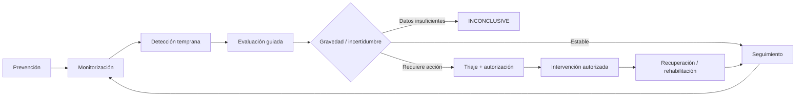

# VIGILE — Base biomédica integral y computable para implementación

## Resumen ejecutivo

Sí: **ya estamos en un punto en el que tiene sentido cerrar la fase de Deep Research general y pasar a Codex**. La investigación se ha convertido en un paquete estructurado que contiene fuentes, extracciones con localizadores, catálogo de condiciones, rutas clínicas, reglas computables, algoritmos, sensores, interacciones multisistema, datasets, matriz de cobertura, vacíos de evidencia, casos sintéticos y una especificación específica para Codex.

La versión oficial vigente al corte de la investigación es **NASA-STD-3001 Volume 1 Revision C, de 15 de septiembre de 2023**, y **Volume 2 Revision F, de 14 de julio de 2026**. Ambos figuran activos en el sistema de estándares de NASA. NASA también deja claro que la aplicación de requisitos concretos a programas puede someterse a *tailoring*, desviaciones o exenciones formalmente aprobadas; por eso VIGILE debe almacenar siempre el contexto y aplicabilidad del requisito, en vez de tratar cada número del estándar como una constante clínica universal. citeturn21search0turn21search4turn21search7

El resultado respeta el objetivo que establecimos desde la investigación inicial: **Prevención → Monitorización → Detección → Evaluación → Triaje → Intervención → Recuperación → Seguimiento**, diferenciando además evidencia espacial, análogos terrestres, decisiones de ingeniería, elementos que necesitan validación y elementos que requieren autorización de misión. fileciteturn0file1

El paquete final contiene **29 archivos**, entre ellos:

| Componente | Resultado |
|---|---:|
| Fuentes registradas | 33 |
| Extracciones primarias estructuradas | 31 |
| Condiciones/riesgos en catálogo | 44 |
| Rutas clínicas condición por condición | 44 |
| Reglas determinísticas estructuradas | 15 |
| Algoritmos transversales | 8 |
| Sensores/biomarcadores iniciales | 21 |
| Interacciones multisistema | 10 |
| Datasets/repositorios verificados | 8 |
| Vacíos críticos documentados | 10 |
| Casos de prueba sintéticos | 12 |

La conclusión más importante es que **“integral” ya no significa que intentemos fingir un diagnóstico y tratamiento completo para cada enfermedad**. Significa que todos los dominios relevantes pueden estar representados en la misma arquitectura, mientras que cada etapa clínica se habilita únicamente hasta el nivel que permite la evidencia.



## Base normativa y reglas computables

La documentación de NASA permite programar ya una primera capa especialmente sólida del Health Intelligence Engine. NASA-STD-3001 no solo regula aspectos médicos: establece requisitos de capacidad aeróbica, fuerza, salud ósea, exposición radiológica, operaciones médicas, ambiente y registro longitudinal que se prestan muy bien a un motor determinístico y trazable. citeturn21search0turn21search4

### Requisitos que ya quedaron traducidos

| Área | Regla preparada | Interpretación correcta |
|---|---|---|
| VO₂max — EVA microgravedad | ≥ **32,9 mL/min/kg** | Requisito de rendimiento, no diagnóstico. citeturn4view0 |
| VO₂max — EVA superficie | ≥ **36,5 mL/min/kg** | Aplicable cuando la misión incluye EVA de superficie. citeturn4view1 |
| VO₂max longitudinal | ≥ **80 % del preflight** | Compara pruebas equivalentes. citeturn4view1 |
| Fuerza muscular | ≥ **80 % del baseline** | Deben coincidir grupo muscular, movimiento y método. citeturn4view2 |
| BMD cadera/columna | ≥ **95 %** del baseline | Requisito de conservación; no probabilidad de fractura. citeturn3view2 |
| BMD cuello femoral | ≥ **90 %** | Mismo caveat: no es por sí solo diagnóstico de fragilidad. citeturn3view2 |
| CO₂ del hábitat | media de **1 h ≤3 mmHg** | Debe calcularse temporalmente; una muestra instantánea no basta. citeturn16view0 |
| PIO₂ | rangos de Table 6.2-1 | La regla incorpora presión, FIO₂ y duración. citeturn16view0 |
| Cambio de presión | ≤ **13,5 psi/min** para cambios >1 psi | Es requisito del sistema/presión, no diagnóstico. citeturn16view1 |
| SANS | incremento OCT peripapilar medio ≥ **20 µm** | Criterio temprano de edema de disco; desencadena evaluación. citeturn21search2 |
| Orina 24 h | ≤ **2 L/día** como señal contextual de riesgo | Asociación con mayor riesgo litogénico, no diagnóstico de cálculo. citeturn18search0 |

La tabla de radiación de NASA también se estructuró conservando **órgano, ventana temporal y tipo de magnitud dosimétrica**, precisamente para impedir que el software mezcle `mGy`, `mGy-Eq` y `mSv` como si fueran intercambiables. NASA proporciona límites distintos para cristalino, piel, órganos hematopoyéticos, sistema circulatorio y SNC, además de factores RBE; esa información exige un modelo tipado de unidades y contexto, no simples comparaciones numéricas. citeturn4view4turn4view5

### Un caso especialmente importante: DCS

Hay una trampa que Codex debe evitar y que ahora está codificada explícitamente. NASA-STD-3001 V2 establece para la **validación terrestre de protocolos de enfermedad por descompresión** un objetivo de menos del 4 % de probabilidad de DCS con 95 % de confianza, sin DCS grave y con evaluación de VGE. El estándar señala que este requisito se utiliza para validar protocolos en pruebas terrestres y **no para decidir en vuelo que un astronauta tiene un 4 % de riesgo**. citeturn16view1

Por eso hemos creado `RULE-DCS-GROUND-VALIDATION` con:

`authorization = NOT_FOR_INFLIGHT_PATIENT_DECISION`

NASA exige además capacidad para tratar DCS y explica la lógica de volver al tripulante hacia su presión inicial de saturación con rapidez; pero el procedimiento médico concreto depende de las capacidades y del protocolo de misión. VIGILE, por tanto, podrá detectar el contexto, organizar la evaluación y solicitar el protocolo autorizado, pero no inventará un tratamiento hiperbárico autónomo. citeturn16view2

### SANS también quedó mucho mejor definido

El consenso internacional publicado en junio de 2026, desarrollado con participación de especialistas de NASA, proporciona criterios públicos mucho más útiles de los que teníamos al inicio. Entre ellos está el incremento promedio de **20 µm de grosor retiniano peripapilar total por OCT** como indicación temprana de edema de disco; el consenso también describe OCT, imagen de fondo, ecografía orbital y otros elementos de monitorización. citeturn21search2

Pero el mismo documento señala que **no existe actualmente un tratamiento establecido para SANS más allá de medidas como la corrección refractiva**; por ello VIGILE puede monitorizar, detectar criterios y gestionar seguimiento, pero no hemos convertido terapias farmacológicas propuestas en un protocolo autónomo. citeturn21search2

## Cobertura integral por especialidad y etapa

El catálogo ya no está limitado al escenario cardiovascular inicial. Contiene **44 condiciones o riesgos** repartidos por cardiovascular, hematología, músculo, hueso, sensorimotor, neurología, oftalmología, sueño, cognición, conducta, inmunología, infección, respiratorio, ambiente, radiación, renal, nutrición, gastrointestinal, dermatología, farmacología, EVA, trauma y emergencias.

La amplitud tiene respaldo en el enfoque de NASA sobre Human System Risks, que trata de forma transversal problemas como VTE, salud conductual, microorganismos, condiciones médicas en vuelo, sensorimotor, hueso, cardiovascular, audición, inmunidad, cargas dinámicas, medicamentos, EVA, DCS, CO₂, nutrición, sueño, radiación, hipoxia, capacidad aeróbica, músculo, cálculo renal, SANS y exposición tóxica. citeturn14search9

La matriz estructurada no responde solamente a “¿está esa enfermedad en VIGILE?”, sino a algo mucho más útil:

**¿hasta qué fase del ciclo clínico podemos llegar con evidencia pública suficiente?**

| Dominio | Monitorización | Detección | Evaluación | Triaje | Intervención | Seguimiento |
|---|---|---|---|---|---|---|
| Aeróbico | Fuerte | Fuerte | Parcial | Validación | Adaptable | Fuerte |
| Fuerza muscular | Fuerte | Fuerte | Parcial | Validación | Adaptable | Fuerte |
| Hueso | Fuerte | Fuerte | Parcial | Validación | Adaptable | Fuerte |
| Ambiente CO₂/O₂ | Fuerte | Fuerte | Parcial | Misión | Misión | Fuerte |
| Radiación | Fuerte | Fuerte | Parcial | Misión | Adaptable | Fuerte |
| SANS | Fuerte | Fuerte | Fuerte | Adaptable | **Validación pendiente** | Fuerte |
| VTE | Fuerte | Adaptable | Adaptable | **Autorización médica** | **No pública/completa** | Adaptable |
| Ortostasia | Fuerte en contexto | Adaptable | Adaptable | Validación | Adaptable | Adaptable |
| Sueño/circadiano | Fuerte | Adaptable | Adaptable | Validación | Adaptable | Adaptable |
| Cognición | Fuerte | Investigación | Adaptable | Validación | Validación | Adaptable |
| Renal/cálculos | Fuerte | Adaptable | Adaptable | Validación | Adaptable | Adaptable |
| Inmunidad | Parcial | Validación | Parcial | Validación | Validación | Parcial |
| Emergencias | Parcial | Parcial | Parcial | Misión | **Bloqueada sin protocolo** | Parcial |

Esto es especialmente importante en VTE. El estudio prospectivo de 2019 en 11 astronautas encontró flujo yugular estancado o reverso en 6 de 11 alrededor del vuelo y detectó un trombo oclusivo en un tripulante; trabajos posteriores describen vigilancia dúplex yugular en varios puntos del vuelo. Es evidencia suficiente para que VIGILE represente y escale hallazgos ecográficos, pero no para que una observación de flujo desencadene anticoagulación automática. citeturn19search1turn19search4

Además, NASA publicó en 2026 una revisión específica del riesgo de tromboembolismo venoso en vuelo espacial mediante un grupo de trabajo, lo que confirma que sigue siendo un ámbito activo de evaluación y que el diseño debe conservar una capa de autorización médica. citeturn14search10

La intolerancia ortostática se trató igualmente de forma contextual. El estudio clásico postvuelo utilizó una prueba de pie de 10 minutos y encontró que 9 de 14 tripulantes no podían completarla después del vuelo, mientras que todos la completaban antes; trabajos de ISS y Shuttle también usaron pruebas en transición a gravedad. Hemos evitado el error de convertir esa prueba en un supuesto procedimiento “de pie” dentro de microgravedad. citeturn19search2turn19search14

En sueño y cognición también se evitó derivar diagnósticos de medias poblacionales. Barger y colaboradores utilizaron actigrafía y registros diarios en tripulaciones Shuttle/ISS y documentaron sueño reducido, mientras que el estudio cognitivo de 2024 evaluó 25 astronautas a través de cinco fases de misión con una batería de diez dominios y corrección por práctica. El valor de −1,5 desviaciones estándar usado en ese trabajo se ha codificado exclusivamente como `RESEARCH_ONLY`, no como criterio de deterioro cognitivo clínico. citeturn19search3turn19search0

También quedaron incorporados los estudios primarios sobre pérdida muscular, contramedidas óseas, alteraciones inmunológicas y riesgo renal. La evidencia espacial muestra cambios considerables de volumen/potencia muscular después de aproximadamente seis meses, beneficios parciales de ejercicio resistido para el hueso, alteraciones adaptativas inmunes persistentes durante misiones largas y relaciones entre volumen urinario y riesgo litogénico. Ninguno de esos resultados poblacionales se ha convertido automáticamente en un “umbral de enfermedad”. citeturn18search1turn18search2turn18search3turn18search0

## Algoritmos, sensores y datos

La biblioteca incluye un conjunto transversal de algoritmos porque VIGILE no puede funcionar únicamente mediante valores fijos. El motor necesita comparar al astronauta consigo mismo, evaluar tendencias, bloquear datos defectuosos y separar anomalía estadística de hallazgo clínico.

Los algoritmos estructurados son:

| Algoritmo | Función | Estado |
|---|---|---|
| `% baseline` | Comparar valor actual con preflight | Clínicamente utilizable donde una fuente da el umbral |
| TWA móvil | Exposiciones como CO₂ | Documentado para ventana de CO₂ |
| Robust z-score | Desviación intraindividual | `ENGINEERING_CHOICE` |
| EWMA | Seguimiento de cambios lentos | `ENGINEERING_CHOICE` |
| k-de-n persistence | Confirmar persistencia | Parámetros `REQUIRES_VALIDATION` |
| Quality Gate | Bloquear señal no fiable | Infraestructura de seguridad |
| Evidence Fusion | Combinar hallazgos | Determinístico, sin inferir causalidad |
| Missingness Engine | Gestionar datos ausentes | Datos requeridos ausentes → `INCONCLUSIVE` |

Por ejemplo, para fuerza o VO₂max el porcentaje respecto al baseline sí tiene sentido porque NASA explícitamente formula requisitos de retención respecto al estado preflight. En cambio, aplicar automáticamente un “z > 2 = enfermo” a cualquier biomarcador sería una invención; por eso los métodos estadísticos genéricos producen *features* y estados de vigilancia, no diagnósticos por sí solos. citeturn4view1turn4view2

También se estructuraron 21 tipos iniciales de mediciones: VO₂max, fuerza, BMD, CO₂, PIO₂, presión, temperatura, humedad, dosimetría, OCT, imagen ocular, flujo y área yugular por ecografía, sueño, cognición, volumen urinario, química urinaria, marcadores inmunes, frecuencia cardiaca, presión arterial y SpO₂. NASA dispone además de un programa de **Spaceflight Standard Measures** que reúne medidas repetidas de sueño/actigrafía, nutrición/fluidos, inmunidad, cognición, sensorimotor, fuerza y otros dominios, lo que favorece la arquitectura multisistema que estamos construyendo. citeturn20search0turn20search3

### Datos disponibles para desarrollar y probar

NASA OSDR reúne datos ómicos, fenotípicos, fisiológicos, conductuales y otros tipos de información; la documentación oficial señala que gran parte puede accederse públicamente, aunque determinados datos de astronautas —especialmente algunos datos de secuenciación— tienen controles adicionales. Esto obliga a diferenciar “dataset encontrado” de “dataset clínico individual descargable y apto para validación”. citeturn12search9

Entre los análogos más útiles está **OS-568**, con 19 participantes masculinos, un periodo de control, 30 días de reposo en cama a −6° y recuperación, incluyendo medidas relacionadas con ortostasia, músculo, hueso, marcha, endocrinología, rendimiento y estado de ánimo. OSD-195 aporta datos musculares/ómicos de 21 días de reposo, pero se ha etiquetado correctamente como dataset mecanístico en vez de dataset de decisiones clínicas. citeturn20search5turn20search6

ESA HREDA complementa NASA con estudios de vuelo y análogos. El acceso a datos científicos requiere registro/autenticación, incluso para datos públicos, y varios conjuntos que hemos catalogado —como AGBRESA Standard Measures, CoSi-500, CardioKine 2 y BRAVITY 2— aparecen con licencias como CC BY-NC 3.0 IGO. citeturn12search0turn12search8turn12search6turn12search13

Esto significa que Codex puede implementar ya adaptadores de datasets y simulación, pero **no debemos afirmar todavía sensibilidad, especificidad o validación clínica de VIGILE con astronautas reales** hasta disponer de muestras apropiadas y realizar una validación formal.

## Límites, seguridad y validación

Esta investigación reduce muchísimo lo que queda pendiente, pero sería científicamente incorrecto decir que ahora tenemos literalmente toda la medicina necesaria para operar autónomamente una misión a Marte.

La principal limitación no es ya “nos faltan artículos generales”. Los vacíos que quedan son mucho más concretos:

| Vacío | Consecuencia para VIGILE |
|---|---|
| Protocolos operativos completos de emergencias no públicos | El sistema puede detectar/escalar, pero no ejecutar tratamientos inventados |
| Acciones off-nominal de CO₂ específicas de misión | Se puede evaluar el requisito de 3 mmHg; la respuesta se carga como configuración autorizada |
| Umbrales clínicos inmunológicos universales | Biomarcadores → tendencias/investigación, no diagnóstico automático |
| Farmacoterapia SANS establecida | Bloqueada |
| Prueba ortostática equivalente en microgravedad | No se inventa |
| Predictor individual validado de fractura astronauta | BMD/QCT ≠ probabilidad automática |
| Umbral clínico cognitivo universal | −1,5 SD queda `RESEARCH_ONLY` |
| PK/PD y estabilidad de todo el formulario | Requiere formulario y protocolo de misión |
| Validación DCS para todos los regímenes futuros de gravedad parcial | Respetar envelope de validación |
| Datos clínicos individuales de astronautas abiertos en cantidad suficiente | No declarar validación clínica a partir de datos sintéticos |

La propia arquitectura médica de exploración de NASA va en esta dirección: los trabajos de ExMC sobre CDSS y operaciones médicas independientes de la Tierra plantean sistemas que integran datos, recursos, evaluación, diagnóstico y selección de respuesta en escenarios con retrasos de comunicación; no implican que un modelo generativo deba inventar medicina cuando no exista protocolo. citeturn0search11turn0search14turn0search20

Por eso la arquitectura final utiliza estados distintos como:

`NORMAL`  
`WATCH`  
`CAUTION`  
`CRITICAL`  
`INCONCLUSIVE`  
`REQUIRES_VALIDATION`  
`REQUIRES_MISSION_AUTHORIZATION`

Y, más importante aún, **estado clínico, estado de datos, cumplimiento normativo y autorización son dimensiones independientes**.

Así evitamos errores peligrosos como:

> “VO₂max <32,9 → enfermedad cardiovascular”

cuando lo que la fuente realmente dice es que no se cumple un requisito de rendimiento aplicable a determinada misión. citeturn4view0

O:

> “DCS probability >4 % → astronauta enfermo”

cuando el 4 % pertenece a la validación de protocolos terrestres. citeturn16view1

O:

> “OCT +20 µm → administrar fármaco”

cuando el consenso SANS permite identificar un criterio, pero no establece una farmacoterapia autónoma estándar. citeturn21search2

## Paquete final para Codex

El paquete completo está listo para entregar a Codex:

**[Descargar VIGILE_FINAL_BIOMEDICAL_KNOWLEDGE.zip](sandbox:/mnt/data/VIGILE_FINAL_BIOMEDICAL_KNOWLEDGE.zip)**

Contiene 29 archivos organizados en la estructura final.

Los cuatro documentos más importantes pueden descargarse también individualmente:

**[Handoff biomédico para Codex](sandbox:/mnt/data/VIGILE_BIOMEDICAL_IMPLEMENTATION_HANDOFF_FOR_CODEX.md)**

**[Especificación de implementación para Codex](sandbox:/mnt/data/VIGILE_CODEX_IMPLEMENTATION_SPECIFICATION.md)**

**[Prompt final para Codex](sandbox:/mnt/data/PROMPT_FINAL_CODEX_AFTER_DEEP_RESEARCH.md)**

**[Informe ejecutivo](sandbox:/mnt/data/VIGILE_FINAL_RESEARCH_EXECUTIVE_REPORT.md)**

Y los artefactos biomédicos centrales están dentro del ZIP en:

```text
VIGILE_FINAL_BIOMEDICAL_KNOWLEDGE/
├── 00_README/
│   ├── README.md
│   ├── EXECUTIVE_REPORT.md
│   └── FIELD_GUIDE.md
├── 01_MASTER_SOURCES/
│   └── MASTER_SOURCE_REGISTRY.csv
├── 02_PRIMARY_EVIDENCE_EXTRACTIONS/
│   └── PRIMARY_EVIDENCE_EXTRACTION.csv
├── 03_CONDITION_CATALOG/
│   ├── MASTER_CONDITION_CATALOG.csv
│   └── MASTER_CONDITION_CATALOG.md
├── 04_CLINICAL_PATHWAYS/
│   ├── COMPLETE_CLINICAL_PATHWAYS.json
│   └── COMPLETE_CLINICAL_PATHWAYS.md
├── 05_COMPUTABLE_RULES/
│   ├── COMPUTABLE_RULE_CATALOG.json
│   └── computable_rule.schema.json
├── 06_ALGORITHMS/
│   ├── BIOMEDICAL_ALGORITHM_LIBRARY.json
│   └── BIOMEDICAL_ALGORITHM_LIBRARY.md
├── 07_SENSORS_BIOMARKERS/
│   └── SENSOR_AND_BIOMARKER_REGISTRY.csv
├── 08_MULTISYSTEM_RELATIONS/
│   ├── MULTISYSTEM_INTERACTION_MATRIX.csv
│   └── MULTISYSTEM_INTERACTION_MATRIX.md
├── 09_DATASETS/
│   └── DATASET_REGISTRY.csv
├── 10_CLINICAL_COVERAGE/
│   └── CLINICAL_COVERAGE_MATRIX.csv
├── 11_EVIDENCE_GAPS/
│   ├── EVIDENCE_GAPS_AND_RISKS.csv
│   └── EVIDENCE_GAPS_AND_RISKS.md
├── 12_CLINICAL_TEST_CASES/
│   ├── CLINICAL_TEST_CASES.json
│   └── CLINICAL_TEST_CASES.csv
├── 13_OFFLINE_RAG_LIBRARY/
│   └── OPERATIONAL_OFFLINE_KNOWLEDGE_LIBRARY.csv
├── 14_CODEX_HANDOFF/
│   ├── CODEX_IMPLEMENTATION_SPECIFICATION.md
│   ├── VIGILE_BIOMEDICAL_IMPLEMENTATION_HANDOFF_FOR_CODEX.md
│   └── PROMPT_FINAL_CODEX.md
├── 15_VALIDATION_AND_LIMITATIONS/
│   ├── VERIFICATION_LOG.csv
│   └── LIMITATIONS.md
└── MANIFEST.json
```

`MANIFEST.json` incluye rutas y hashes SHA-256 para poder controlar exactamente qué versión de la biblioteca utilizó Codex.

La extracción primaria contiene localizadores de página, sección, tabla y figura allí donde pudieron verificarse. En vez de copiar grandes fragmentos textuales protegidos, conserva el localizador exacto, la información cuantitativa pertinente y una paráfrasis computacional; Codex puede volver al documento original para verificar el *wording* cuando sea necesario.

Para la biblioteca offline también se ha separado disponibilidad pública de derechos de redistribución. Por ejemplo, NASA marca sus estándares actuales como disponibles públicamente por internet; el consenso SANS 2026 está publicado bajo CC BY 4.0; y las condiciones de artículos editoriales y datasets ESA varían. “Puedo descargarlo” no se trata automáticamente como “puedo redistribuirlo dentro de cualquier paquete”. citeturn21search0turn21search4turn21search2turn12search8

## Dictamen de implementación

**Sí: ahora le pasaría el ZIP completo y el prompt final a Codex.**

Ya no le pediría a Codex que “investigue medicina espacial y decida qué programar”. Le estamos entregando algo mucho mejor:

**evidencia → localizador → condición → etapa clínica → regla → autorización → prueba esperada.**

La primera versión de Codex debería implementar de extremo a extremo los módulos más sólidos —VO₂, fuerza, BMD, CO₂, PIO₂/presión, radiación, SANS OCT, VTE guiado, ortostasia contextualizada y riesgo renal— y, simultáneamente, cargar los demás dominios dentro de la misma arquitectura para que VIGILE sea integral desde el principio.

Eso no significa que nos quedemos únicamente con esos módulos. Significa que **son los primeros que pueden producir comportamiento biomédico real y trazable**, mientras inmunología, infección, salud conductual, farmacología, trauma, emergencias y otros dominios disponen desde ya de modelos, pathways y estados de cobertura preparados para incorporar protocolos autorizados.

La parte arquitectónica también está bien alineada con el problema de exploración: NASA investiga explícitamente sistemas de apoyo a decisiones y operaciones médicas con creciente independencia de la Tierra, donde los datos históricos/actuales, recursos disponibles y protocolos deben asistir al tripulante en evaluación y respuesta bajo retrasos de comunicación. citeturn0search11turn0search14turn0search20

**No recomendaría otro Deep Research general.** A partir de aquí, la investigación que quede debe ser quirúrgica: por ejemplo, conseguir un protocolo operacional específico que no sea público, inspeccionar el diccionario de un dataset concreto, resolver una discrepancia detectada por Codex o validar una nueva condición. La fase de “buscar toda la medicina espacial otra vez” ya no aporta tanto valor como **programar, probar, detectar huecos reales y volver únicamente sobre esos huecos**.