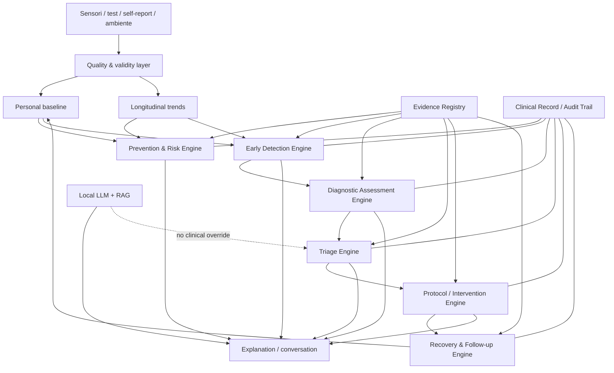
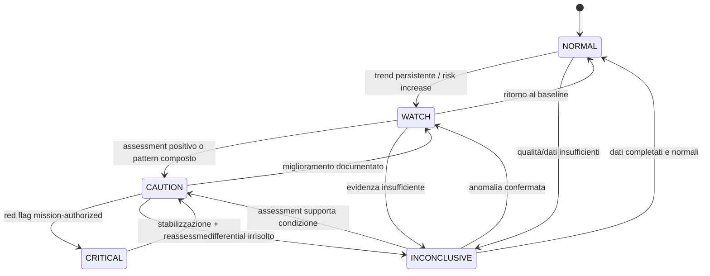
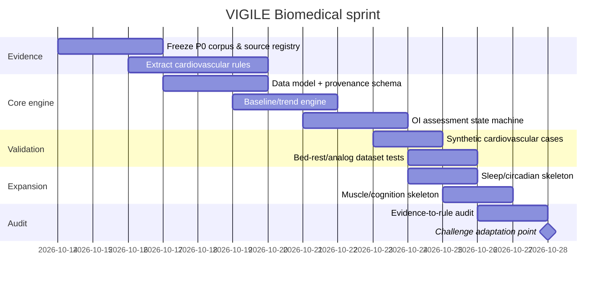

# VIGILE Biomedical / Health Intelligence — base documentale verificata per l’implementazione

## Executive summary

Questa ricerca è stata costruita sul perimetro funzionale definito nel brief VIGILE fornito: un sistema **offline**, con un *Health Intelligence Engine* deterministico e tracciabile che copra prevenzione, monitoraggio, rilevazione precoce, valutazione diagnostica, triage, intervento, recupero e follow-up, mantenendo il LLM come livello di interazione e consultazione e non come decisore clinico. fileciteturn0file0

La conclusione principale è che **l’architettura prevista per VIGILE è sorprendentemente allineata con la direzione attuale della NASA per la medicina di esplorazione**. NASA-STD-3001 Volume 1 include esplicitamente requisiti relativi a diagnosi, intervento, trattamento, assistenza e contromisure; la sezione Health and Medical Care contempla inoltre la necessità di capacità mediche autonome in funzione del profilo di missione. citeturn22view0turn23search0 NASA ExMC ha già definito un’architettura di *Clinical Decision Support System* nella quale l’equipaggio deve poter rilevare, diagnosticare, trattare e prevenire eventi medici con crescente autonomia, mentre il più recente concetto **Earth-Independent Medical Operations — EIMO** integra sensori, diagnostica point-of-care, basi di conoscenza e supporto decisionale a bordo. citeturn24view0turn24view1 Anche il progetto NASA **CHP-IDSP** sta costruendo una piattaforma con modelli dati comuni e API per integrare dati medici, ambientali, di esercizio, sonno e performance: concettualmente è molto vicino al backend sanitario che VIGILE dovrebbe imitare in scala da prototipo. citeturn22view3

La ricerca porta però a una seconda conclusione altrettanto importante: **non esiste nel dominio pubblico un singolo manuale NASA dal quale copiare direttamente tutte le regole cliniche**. NASA-STD-3001 prescrive che ogni programma produca un Crew Health Operations Concept e un documento di requisiti medici operativi, storicamente un MORD; una parte della documentazione operativa dettagliata non è pubblica. citeturn22view1 Perfino il recente Evidence Report osseo rimanda per alcuni requisiti a documentazione medica NASA interna. citeturn24view2 Di conseguenza, VIGILE deve distinguere rigorosamente tra:

**NASA_STANDARD → SPACEFLIGHT_EVIDENCE → ANALOG_EVIDENCE → TERRESTRIAL_GUIDELINE → ENGINEERING_CHOICE → REQUIRES_VALIDATION.**

Questa distinzione dovrebbe essere memorizzata in ogni regola.

Per un prototipo prima del 28 ottobre, i quattro domini con il miglior rapporto tra rilevanza, dati, misurabilità e possibilità di traduzione in software sono:

| Dominio | Cosa è già realisticamente implementabile | Maturità per VIGILE |
|---|---|---|
| **Cardiovascolare** | baseline individuale, trend, stand test, intolleranza ortostatica/presincope, monitoraggio HR/BP/MAP, escalation | **Molto alta** |
| **Muscolo-scheletrico** | variazione forza/endurance, exercise adherence, DXA/QCT come dati periodici, recovery | **Alta** |
| **Sonno/circadiano** | actigraphy, durata/efficienza, timing, light exposure, trend, fatigue coupling | **Molto alta** |
| **Cognitivo/comportamentale** | NASA Cognition Battery, z-score rispetto al baseline, actigraphy + self-report + performance | **Alta per cognition; media per diagnosi psichiatrica** |

NASA identifica l’intolleranza ortostatica come uno dei principali outcome cardiovascolari operativi, mentre i dati più recenti su astronauti di lunga durata consentono perfino di costruire una prima procedura di *stand assessment* strutturata. citeturn26view1turn17search6 Per il sistema muscolare sono disponibili dati ISS longitudinali su forza, capacità aerobica ed efficacia incompleta delle contromisure. citeturn16search3turn16search7turn16search10 Per il sonno esistono actigraphy reale ISS, studi di disallineamento circadiano e un Evidence Report NASA dedicato. citeturn16search2turn15search13turn26view0 Per la cognizione, NASA dispone di una batteria standardizzata e nel 2024 è stato pubblicato il maggiore dataset preliminare di performance Cognition su astronauti ISS, con misure corrette per *practice effects*. citeturn26view5turn15search12

La prima versione **non dovrebbe invece automatizzare terapia farmacologica, diagnosi psichiatrica, anticoagulazione per VTE o predizione individuale di frattura**. Le fonti pubbliche sono insufficienti per rendere tali decisioni affidabili e mission-authorized; nel caso VTE, NASA continua a produrre valutazioni e working group ancora nel 2025–2026. citeturn26view7turn10search7

Il principio implementativo raccomandato è quindi:

> **VIGILE può automatizzare ciò che la fonte permette di rendere deterministico; dove la fonte non fornisce la decisione, il software deve restituire `INCONCLUSIVE` o `REQUIRES_VALIDATION`, non inventare la medicina.**

## Corpus documentale e biblioteca prioritaria

### Standard e architettura che devono diventare la “costituzione” di VIGILE

I due documenti normativi fondamentali sono **NASA-STD-3001 Volume 1 Rev. C**, pubblicato nel 2023, e **Volume 2 Rev. F**, aggiornato nel luglio 2026. Il primo riguarda direttamente salute e assistenza medica; il secondo integra prestazioni umane, ambiente, habitability e requisiti del sistema con cui l’equipaggio interagisce. citeturn21view0turn23search1

Tre requisiti di Volume 1 sono particolarmente importanti per il codice. La sezione Scope stabilisce che il volume copre diagnosi, intervento, trattamento e contromisure; la sezione Medical Operations richiede CHOC e requisiti medici specifici del programma; la sezione Crew Health Records richiede che **tutti i risultati del monitoraggio sanitario siano conservati in formato permanente e recuperabile anche per trend analysis**, con trasmissione e archiviazione sicure. citeturn22view0turn22view1turn22view2

Questo rende consigliabile che VIGILE non sia concepito come una raccolta di `if` indipendenti, ma come un sistema clinico versionato, auditabile e data-driven.



La separazione tra dati integrati, CDS e interfaccia è coerente sia con ExMC CDSS sia con EIMO e CHP-IDSP; EIMO, in particolare, descrive un sistema che integra database di riferimento, sensori wearable, diagnostica point-of-care e controlli ambientali per supportare il Crew Medical Officer quando il supporto terrestre è ritardato o indisponibile. citeturn24view0turn24view1turn22view3

### Inventario maestro delle fonti

La tabella seguente raccoglie il **corpus principale verificato**. Non sostengo che rappresenti letteralmente ogni documento esistente al mondo: è il corpus pubblico ad alta utilità ingegneristica trovato e verificato per costruire il prototipo. Il CSV allegato contiene una versione più ampia con URL completi, licenze e metadata strutturati.

| ID | Documento / ente | Anno/versione | Tipo e sistema | Utilizzo concreto in VIGILE | Accesso | Priorità |
|---|---|---:|---|---|---|---|
| STD-V1 | NASA-STD-3001 Vol. 1: Crew Health | Rev. C, 2023 | Standard / trasversale | autorità di base per health care, diagnosi, trattamento, countermeasures | pubblico NASA | **P0** citeturn23search1turn22view0 |
| STD-V2 | NASA-STD-3001 Vol. 2 | Rev. F, 2026 | Standard / trasversale | human factors, ambiente, medical-system integration | pubblico NASA | **P0** citeturn21view0 |
| STD-HMC | Vol. 1 §3 Health and Medical Care | corrente | Requisiti clinici | prevenzione, capacità diagnostico-terapeutiche, autonomia, PRA | pubblico NASA | **P0** citeturn23search0 |
| STD-MEDOPS | Vol. 1 §6 Medical Operations | corrente | Requisiti operativi | CHOC/MORD, health evaluation, BHP, postflight reconditioning | pubblico NASA | **P0** citeturn22view1 |
| STD-RECORDS | Vol. 1 §7 Crew Health Records | corrente | Data governance | trend analysis, audit, storage, security | pubblico NASA | **P0** citeturn22view2 |
| EXMC-CDSS | ExMC Clinical Decision Support System Architecture Recommendation, HRP-48032 Rev. B | 2023 | Architettura CDS | struttura del motore autonomo e Medical Data Architecture | pubblico; contiene parti copyright | **P0** citeturn24view0 |
| EIMO | Earth-Independent Medical Operations ConOps | 2025 | ConOps | autonomia deep-space, CMO, sensors/POC/reference DB | Public Use Permitted | **P0** citeturn24view1 |
| CHP-IDSP | Crew Health and Performance Integrated Data System Platform | 2025 | Data architecture | common data model/API per medical, sleep, exercise, environment | Public Use Permitted | **P0** citeturn22view3 |
| CV-RISK | NASA Cardiovascular Risk record + DAG | agg. 2025 | Risk model / cardio | ontologia, perfusione, OI, dysrhythmia, VTE, countermeasures | pubblico NASA | **P0** citeturn26view1 |
| CV-DAG | Cardiovascular Risk DAG Narrative | corrente | DAG clinico | dipendenze causali tra fitness, volume, perfusione, OI, arrhythmia | pubblico NASA | **P0** citeturn7view0 |
| OI-ISS | *Orthostatic Intolerance After ISS and Space Shuttle Missions* | 2015 | Studio astronauti | tilt test e recovery; ground truth di OI | PubMed/DOI | **P0** citeturn17search7 |
| OI-GCG | *Cardiovascular responses to standing… after long-duration spaceflight* | 2025 | Studio astronauti | test prone→standing, ΔHR/ΔMAP, recupero R+0–R+30 | PubMed | **P0** citeturn17search6 |
| OI-COMP | *Efficacy of Gradient Compression Garments…* | 2020 | Studio astronauti | countermeasure e risposta emodinamica | PubMed | **P1** citeturn17search15 |
| VTE-25 | *Assessment of Risk of Venous Thromboembolism during Spaceflight* | 2025 | NASA assessment | VTE monitoring/triage e limiti | pubblico NASA | **P1** citeturn26view7 |
| VTE-WG | NASA VTE Working Group — April 2026 | 2026 | Working group | aggiornamento VTE per esplorazione | pubblico NASA | **P1** citeturn10search7 |
| ACC-SYNC | ACC/AHA/HRS Syncope Guideline | 2017 | Linea guida terrestre | anamnesi, esame, ECG, red flags; **adattamento** | copyright societies | **P1** citeturn17search0turn17search1 |
| MUSCLE-RISK | NASA Muscle Risk | corrente | Risk model | performance muscolare e countermeasures | pubblico NASA | **P0** citeturn26view2 |
| MUSCLE-ER | NASA Muscle/Aerobic Evidence Report | 2023 | Evidence Report | variabilità, strength/endurance/aerobic losses, gaps | pubblico NASA | **P0** citeturn6view1 |
| MUSCLE-ISS | *Isokinetic Strength Changes Following Long-Duration Spaceflight* | 2015 | Studio astronauti | forza per joint/muscle, baseline, R+30 | PubMed | **P0** citeturn16search3 |
| SPRINT | *High intensity training during spaceflight: NASA Sprint Study* | 2020 | Studio astronauti | countermeasure exercise e outcome multisistema | PubMed | **P1** citeturn16search7 |
| MULTISYS | *Effects of exercise countermeasures on multisystem function…* | 2023 | Studio astronauti | eterogeneità individuale, exercise effectiveness | PubMed | **P1** citeturn16search10 |
| BONE-ER | *Risk of Bone Fracture due to Spaceflight-induced Changes to Bone* | 2024 | Evidence Report | DXA, QCT, biomarkers, PRA, recovery, countermeasures | Public Use Permitted | **P0** citeturn24view2 |
| BONE-ARED | *Resistive exercise… partial protection against bone loss* | 2019 | Studio astronauti | ARED, QCT/DXA e bone turnover | PubMed | **P1** citeturn16search5 |
| SLEEP-ER | NASA Sleep/Circadian/Workload Evidence Report | 2016 | Evidence Report | sleep loss, circadian misalignment, workload, gaps | Public Use Permitted | **P0** citeturn26view0 |
| SLEEP-OBS | *Prevalence of sleep deficiency… astronauts* | 2014 | Studio astronauti | actigraphy, sleep logs, baseline/flight | PMC/editor | **P0** citeturn16search9 |
| CIRCADIAN | *Circadian misalignment affects sleep… spaceflight* | 2017 | Studio astronauti | actigraphy, photometry, phase estimation | PubMed | **P0** citeturn15search13 |
| ACTIGRAPHY | *Wrist actigraphic measures of sleep in space* | 1999 | Studio astronauti | confronto actigraphy–PSG | PubMed | **P1** citeturn16search2 |
| AASM-ACT | AASM guideline on actigraphy | 2018 | Guideline terrestre | quality/appropriate use of actigraphy | copyright AASM | **P1** citeturn18search7 |
| BHP-ER | NASA Behavioral Health Evidence Report | 2025 | Evidence Report | cognition, behavior, psychiatric risk, isolation | pubblico NASA | **P0** citeturn26view6 |
| BHP-SM | NASA BHP Standard Measures | 2018/2019 | Standard measures | cognition, actigraphy, physiology, mood/team reports | Public Use Permitted | **P0** citeturn19search0 |
| SPACE-SM | *Standard Measures During Spaceflight* | 2023 | Longitudinal protocol | schedule di raccolta sleep, cognition, CV, immune, team | pubblico NASA | **P0** citeturn19search1 |
| COG-NORM | *Cognition and Fine Motor Skills Test Batteries* | 2020 | NASA TM | test battery e normative astronaut-like | pubblico NASA | **P0** citeturn26view5 |
| COG-ISS | *Cognitive performance in ISS astronauts…* | 2024 | Studio astronauti | practice-corrected z-score e longitudinal baseline | PubMed | **P0** citeturn15search12 |
| ISOL-SM | *Isolation Standard Measures* | 2022 | International/NASA standard measures | sleep, mood, cognition, stress, immune, team | pubblico | **P1** citeturn19search5 |
| APEX | NASA APEX Standardized Suite | 2026 | Isolamento + spaceflight | behavioral/team longitudinal trends | pubblico NASA | **P1** citeturn19search9 |

### Priorità P0, P1 e P2

**P0 significa “necessario prima di scrivere una regola clinica”**. Comprende gli standard NASA, EIMO/ExMC/CHP-IDSP, i quattro Risk/Evidence corpus prioritari e gli studi primari necessari per costruire i primi casi. Questi documenti definiscono non solo cosa monitorare, ma anche quali informazioni VIGILE deve conservare e quali limiti applicare. citeturn22view0turn24view0turn22view3

**P1 significa “necessario per rafforzare o validare il prototipo”**: studi su countermeasures, linee guida terrestri impiegate esclusivamente come adattamenti, VTE, isolation measures e dataset analoghi. Nessuna fonte P1 terrestre dovrebbe sovrascrivere un requisito NASA o essere etichettata come *space-validated*. citeturn17search0turn19search5

**P2 significa “ricerca avanzata, meccanismi o estensioni future”**: omics, farmacologia non operativa, modelli sperimentali e documentazione che non produce direttamente una regola implementabile. Gli OSDR omics, ad esempio, sono preziosi per ricerca biologica, ma non giustificano automaticamente soglie cliniche per l’equipaggio. NASA OSDR stesso distingue dati open, dati human-derived controllati e differenti regimi di licenza. citeturn20search0turn20search4turn20search5

**File operativo:** [scarica l’inventario maestro completo in CSV](sandbox:/mnt/data/vigile_deep_research/vigile_inventario_maestro_fonti.csv).

## Matrice rischio–indicatore–decisione

La seguente matrice è intenzionalmente conservativa: distingue ciò che può essere trasformato oggi in logica deterministica da ciò che richiede una soglia mission-specific o revisione clinica.

| Rischio | Indicatori/inputs | Baseline e detection | Valutazione/decisione | Intervento e follow-up | Implementabilità |
|---|---|---|---|---|---|
| **Intolleranza ortostatica / presincope** | HR, BP/MAP, postura, sintomi; ECG e stroke volume se disponibili | stand test personale + trend CV | sintomi + risposta emodinamica anomala vs baseline; sincope/red flags → escalation | protocollo autorizzato; retest e recovery trend | **Alta**, ma i cut-off finali devono essere mission-authorized. NASA considera l’OI un rischio cardiovascolare operativo primario. citeturn26view1turn17search6 |
| **Decondizionamento aerobico** | workload, HR, VO₂/VO₂peak quando disponibile | preflight exercise baseline | % change e trajectory; non un unico valore assoluto | adattamento exercise solo da prescription autorizzata | **Alta per monitoring**, media per action thresholds. citeturn16search4turn16search10 |
| **VTE** | ecografia IJV/flow se disponibile, sintomi, contesto, fattori di rischio | imaging/clinical baseline | sospetto → imaging/medical escalation; trombo documentato → human clinical decision | **nessuna anticoagulazione automatica** nel prototipo | **Media per detection, bassa per treatment automation**. Il rischio è tuttora oggetto di assessment NASA. citeturn26view1turn26view7turn10search7 |
| **Perdita di forza** | test isocinetici/funzionali, exercise load, endurance | preflight individuale | % change per joint/muscle group e trend | exercise countermeasure + adherence tracking | **Alta**. Dati ISS mostrano perdite medie e recupero misurabile postflight. citeturn16search3 |
| **Decondizionamento multisistema** | strength, agility, aerobic capacity, BMD | preflight | vector di deviazioni per sistema, non media unica | countermeasure e follow-up per dominio | **Alta per detection**; forte variabilità interindividuale. citeturn16search7turn16search10 |
| **Perdita ossea / rischio frattura** | DXA, QCT, bone-turnover markers | preflight + misure periodiche | interpretazione longitudinal + QCT; non derivare fragility da sola % loss | countermeasure autorizzata + postflight surveillance | **Media**, perché non è un sensore continuo. Il report NASA avverte che DXA non cattura tutta la perdita/recupero e che non esiste un cut-off di % loss direttamente correlato alla fragilità astronautica. citeturn24view2 |
| **Sleep deficiency** | actigraphy, sleep onset/offset, durata, efficienza, diary, workload | più notti preflight | deviazione persistente personale + performance | scheduling/light/behavioral measures autorizzate; follow-up actigraphy/cognition | **Molto alta**. Actigraphy è stata direttamente studiata in volo. citeturn16search2turn16search9 |
| **Circadian misalignment** | sleep timing, light exposure, schedule, fase stimata | profilo preflight | misalignment sleep–circadian phase | timed-light/schedule protocol; reassessment | **Alta come risk flag**, ma l’algoritmo specifico di phase estimation utilizzato nella letteratura non va assunto open/reimplementabile senza verifica. citeturn15search13turn26view0 |
| **Cognitive decrement** | speed/accuracy nei subtest Cognition | repeated preflight baseline, practice correction | z-score per dominio; nello studio ISS, ≤−1,5 SD è stato usato come criterio esplorativo di shift significativo | workload/rest/BHP assessment e retest | **Molto alta come performance assessment**, non come diagnosi neurologica. citeturn15search12turn26view5 |
| **Behavioral deterioration** | self-report validati, mood, team/social measures, sleep, physiology | baseline personale/team | pattern longitudinali multipli; evitare diagnosi da singolo score | BHP protocol / CMO escalation | **Media**: NASA dispone di Standard Measures, ma non tutti i cut-off operativi sono pubblici. citeturn19search0turn19search4turn26view6 |

Un punto particolarmente importante emerge dagli **Spaceflight Standard Measures**: NASA raccoglie deliberatamente più sistemi nello stesso framework — sonno, cognizione, stato immunitario, chimica sangue/urine, cardiovascolare, sensorimotor e team processes — e utilizza misurazioni preflight e inflight ripetute. Questo è un forte argomento a favore dell’approccio di VIGILE basato su baseline personali e integrazione multisistema, invece di limiti popolazionali isolati. citeturn19search1turn19search2

Il CSV permette di modificare questa matrice direttamente in Excel/Sheets: [scarica la matrice rischio–indicatore–decisione](sandbox:/mnt/data/vigile_deep_research/vigile_matrice_rischio_indicatore_decisione.csv).

## Algoritmi, protocolli traducibili in codice e schema dati

### Componenti già traducibili

| Componente | Logica traducibile | Fonte e locator | Stato |
|---|---|---|---|
| **Persistent health record** | ogni misura, evento, regola, decisione e outcome deve essere persistente e recuperabile | NASA-STD-3001 V1 **§7.1, V1 7001** | **Implementare subito**. citeturn22view2 |
| **Medical operations provenance** | protocollo e requisiti devono appartenere a una configurazione missione/versione | V1 **§6.5, V1 6008–6009** | **Implementare subito**. citeturn22view1 |
| **Stand assessment** | 2 min prone → 3,5 min standing; monitor HR/MAP e sintomi | studio long-duration astronauti 2025, Methods | **Implementabile come assessment**, non come diagnosi universale. citeturn17search6 |
| **Classical OI evidence test** | 10 min, 80° head-up tilt; completion/presyncope come outcome | ISS/Shuttle study 2015, Methods | utile per validation/simulation; meno semplice per uso quotidiano. citeturn17search7 |
| **Cognition longitudinal score** | speed/accuracy → practice correction → z-score vs baseline | ISS Cognition study 2024 | **Implementabile**; −1,5 SD va etichettato come research shift, non diagnosis. citeturn15search12 |
| **Sleep actigraphy** | onset, offset, duration, efficiency su più notti | space actigraphy + NASA sleep evidence | **Implementabile** con controllo qualità. citeturn16search2turn26view0 |
| **Muscle deterioration** | `(current - baseline) / baseline × 100` per strength/endurance metric | ISS strength study + NASA muscle evidence | **Implementabile come trend**; decision band da validare. citeturn16search3turn6view1 |
| **Bone surveillance** | DXA/QCT longitudinali + turnover markers | Evidence Report: DXA pp. 8–19; QCT p.20; markers p.21; models pp.24–28; countermeasures pp.35–39 | **Periodico**, non real-time. citeturn24view2 |
| **Clinical decision support architecture** | data → rules/analytics → evidence/context → decision support | ExMC HRP-48032 Rev B | **Implementare architetturalmente**. citeturn24view0 |
| **Earth-independent operation** | local reference DB + sensors + POC + training + CMO support | EIMO ConOps | **P0 requirement di design**. citeturn24view1 |

### Baseline e anomaly detection

NASA richiede esplicitamente la conservazione dei dati per **trend analysis**, mentre gli Standard Measures mostrano l’uso di misure longitudinali preflight/inflight; non prescrive però nel materiale pubblico una singola formula universale di anomaly detection per tutti i parametri. citeturn22view2turn19search1

Per questo propongo di separare l’algoritmo statistico dalla regola clinica. Ad esempio:

\[
\Delta_{\%}(t)=100\frac{x(t)-B_x}{B_x}
\]

con \(B_x\) baseline individuale, e per segnali abbastanza stabili:

\[
z_{\text{robust}}(t)=
\frac{x(t)-\operatorname{median}(B)}
{1.4826\,MAD(B)}
\]

più una componente temporale, per esempio:

\[
EWMA_t=\lambda x_t+(1-\lambda)EWMA_{t-1}
\]

**Queste formule sarebbero scelte ingegneristiche di VIGILE, non soglie cliniche NASA.** Devono quindi avere `evidence_type = ENGINEERING_CHOICE` e non devono da sole produrre una diagnosi.

Una regola potrebbe richiedere contemporaneamente:

\[
\text{SignalQuality}
\land
\text{Deviation}
\land
\text{Persistence}
\land
\text{ClinicalContext}
\]

prima di cambiare stato. Questo è particolarmente importante perché NASA documenta ampia variabilità interindividuale nelle risposte muscolari e multisistema al volo spaziale. citeturn16search10turn6view1

### State machine clinica



`INCONCLUSIVE` è essenziale: la documentazione NASA stessa identifica numerosi gap ancora aperti, per esempio biomarcatori circadiani facilmente acquisibili in volo, performance metrics e capacità di personalizzare le contromisure. citeturn26view0

### Schema JSON proposto

Ogni regola dovrebbe essere una risorsa versionata e non codice hard-coded disperso:

```json
{
  "rule_id": "CV-OI-001",
  "version": "0.1.0",
  "status": "REQUIRES_VALIDATION",
  "domain": "cardiovascular",
  "purpose": "early_detection",

  "inputs": [
    {
      "variable": "heart_rate",
      "unit": "bpm",
      "source": "wearable",
      "quality_required": 0.90,
      "baseline_ref": "BASELINE-HR-001"
    },
    {
      "variable": "mean_arterial_pressure",
      "unit": "mmHg",
      "source": "bp_monitor",
      "quality_required": 0.95
    },
    {
      "variable": "posture",
      "unit": "category",
      "source": "assessment"
    },
    {
      "variable": "presyncope_symptoms",
      "unit": "boolean",
      "source": "guided_questionnaire"
    }
  ],

  "logic": {
    "kind": "composite",
    "expression": "MISSION_CONFIGURED_LOGIC",
    "temporal_window": "stand_assessment",
    "missing_data_policy": "insufficient_evidence",
    "confounders": [
      "exercise_recent",
      "hydration_status",
      "medication_context"
    ]
  },

  "outputs": {
    "state": "CAUTION",
    "assessment_code": "ORTHOSTATIC_RESPONSE_ABNORMAL",
    "confidence": "MODERATE",
    "next_protocol_id": "CV-OI-ASSESS-002"
  },

  "evidence": [
    {
      "source_id": "OI-GCG-2025",
      "locator": "Methods: prone-to-standing protocol",
      "evidence_type": "SPACEFLIGHT_PRIMARY",
      "applicability": "DIRECT"
    },
    {
      "source_id": "CV-RISK",
      "locator": "Cardiovascular Risk DAG",
      "evidence_type": "NASA_EVIDENCE_REPORT",
      "applicability": "DIRECT"
    }
  ],

  "validation": {
    "test_suite_id": "CV-OI-TEST-001",
    "reviewer_role": "biomedical_clinical_reviewer",
    "known_failure_modes": [
      "poor_bp_signal",
      "recent_exercise",
      "missing_symptom_assessment"
    ]
  }
}
```

La soglia non è intenzionalmente compilata: la letteratura pubblica consente di implementare il **protocollo di assessment e la comparazione con il baseline**, ma non giustifica inventare un singolo threshold astronaut-specific universale. citeturn17search6turn26view1

Il file completo è disponibile qui: [scarica `vigile_rule_schema.json`](sandbox:/mnt/data/vigile_deep_research/vigile_rule_schema.json).

## Dataset, licenze e biblioteca offline

### Dataset più utili

La migliore strategia di validazione non è cercare immediatamente un enorme dataset di astronauti — che non esiste pubblicamente in forma clinica completa — ma combinare **dati spaceflight pubblicati + dataset bed-rest/analog + test sintetici controllati**. NASA OSDR rende molti dataset pubblici direttamente scaricabili, ma i dati human-derived più sensibili possono essere a controlled access e soggetti a IRB/Data User Agreement. citeturn20search2turn20search4turn20search5

| Dataset | Contenuto utile | Uso VIGILE | Limite principale |
|---|---|---|---|
| **NASA OSD-568 — Exercise Countermeasure for Bedrest Deconditioning** | 30 giorni HDBR; capacità lavorativa, forza, orthostatic tolerance, gait, BMD, endocrine, fluid/electrolyte, performance/mood | migliore candidato NASA analog multisistema per test del motore | bed-rest terrestre e coorte limitata, non volo reale. citeturn13search0 |
| **OSD-195 / GLDS-195** | 21 giorni bed rest, human skeletal muscle gene expression | ricerca muscolare/meccanismi | omics, non fonte diretta di threshold clinici. citeturn13search2 |
| **OSD-198** | bed rest + hypoxia, miRNA muscolare | confounder/environment studies | omics e coorte ridotta. citeturn13search3 |
| **OSD-942** | 70-day bed rest, vastus lateralis | trajectory lunga muscolare | prevalentemente molecular/omics. citeturn13search4 |
| **OSD-946** | 70-day HDBR + SPRINT exercise | validazione countermeasure/trend | analog, non astronaut mission data. citeturn13search9 |
| **ESA AGBRESA Muscle/Artificial Gravity** | 60-day bed rest + AG | forza e interazione neuromuscolare | analog terrestrial. DOI 10.57780/esa-3v2wrqx. citeturn26view8 |
| **ESA AGBRESA Spaceflight Standard Measures** | standard-measures dataset | test di data model multisistema | richiede autenticazione HREDA. DOI 10.57780/esa-3omp4np. citeturn26view9 |
| **ESA CAROT** | cardiovascular deconditioning da long-term bed rest | sviluppo/validation OI e cardio trend | analog terrestrial. DOI 10.57780/esa-g3lxiiq. citeturn12search1 |
| **ESA BRACE Baseline** | baseline bed-rest study | baseline simulator e unit tests | non spaceflight. DOI 10.57780/esa-3nbdkc9. citeturn14search9 |
| **ESA LOADS** | artificial gravity, bone + cardiovascular deconditioning | countermeasure model | analog. DOI 10.57780/esa-moo1k5v. citeturn12search11 |
| **ESA BRAVITY2** | brain/cognitive changes durante long bed rest | cognitive trajectory testing | bed-rest ≠ isolation/radiation environment. DOI 10.57780/esa-7v4u9f4. citeturn14search7 |

ESA HREDA è un archivio ufficiale di dati Human and Robotic Exploration e richiede autenticazione per scaricare anche dataset pubblici; i dataset verificati sopra riportano tipicamente **CC BY-NC 3.0 IGO** nelle rispettive schede. citeturn14search2turn14search6

NASA OSDR consente accesso e riuso dei dataset pubblici secondo le policy NASA, ma **la licenza va verificata dataset per dataset**. La policy NASA distingue dati con licenza esplicita, dati di missioni NASA che in assenza di restrizioni possono essere distribuiti CC0 e dati per i quali NASA non è necessariamente la fonte originale. citeturn20search0turn20search1

[Scarica il catalogo dataset in CSV](sandbox:/mnt/data/vigile_deep_research/vigile_datasets.csv).

### Copyright e RAG offline

Per la futura biblioteca RAG conviene mantenere due repository separati:

**Development Library**: tutto ciò che il team può legalmente consultare durante ricerca e sviluppo.

**Operational Library**: solo documenti che possono essere effettivamente memorizzati e distribuiti nel pacchetto offline di VIGILE.

Questo è necessario perché *pubblicamente leggibile* non equivale a *redistribuibile*. Molti record NTRS indicano esplicitamente `Public Use Permitted`, ma non tutti; per esempio il documento ExMC CDSS specifica che alcune porzioni possono includere materiale protetto da copyright. citeturn24view0 Gli abstract PubMed non conferiscono automaticamente diritto di redistribuire il PDF dell’editore. Le linee guida AASM e ACC sono materiale di società scientifiche con propri diritti d’autore. citeturn18search11turn17search0

La struttura raccomandata è:

```text
VIGILE_Biomedical_Library/
├── 00_Standards_and_Architecture/
│   ├── NASA_STD_3001/
│   ├── EIMO_ExMC_CDSS/
│   └── Data_Architecture/
├── 01_Cardiovascular/
│   ├── Risks_DAGs/
│   ├── Orthostatic_Intolerance/
│   ├── VTE/
│   └── Countermeasures/
├── 02_Musculoskeletal/
│   ├── Muscle/
│   ├── Bone/
│   └── Exercise_Countermeasures/
├── 03_Sleep_Circadian/
├── 04_Behavioral_Cognitive/
├── 05_Clinical_Guidelines_Terrestrial/
├── 06_Sensors_and_Measurement/
├── 07_Algorithms_Baselines_Trends/
├── 08_Datasets/
│   ├── NASA_OSDR/
│   └── ESA_HREDA/
├── 09_Rules_JSON/
├── 10_Test_Cases_Synthetic/
├── 11_Validation/
├── 12_Licenses_and_Rights/
└── 13_RAG_Operational_Library/
```

[Scarica la struttura di cartelle](sandbox:/mnt/data/vigile_deep_research/struttura_cartelle_consigliata.txt).

## Piano di implementazione biomedical

### Scenari clinici da sviluppare per primi

Non consiglierei di implementare subito venti patologie. Il prototipo sarebbe molto più credibile con quattro o cinque **closed-loop scenarios**, ciascuno completo dall’early prevention al follow-up.

| Ordine | Scenario | Perché è forte | Ciclo implementabile |
|---|---|---|---|
| **A** | **Cardiovascular deconditioning → orthostatic intolerance/presyncope** | NASA lo identifica come rischio operativo centrale; HR/BP e posture sono semplici; esistono test e studi spaceflight | prevention → monitoring → stand assessment → differential/triage → countermeasure protocol → reassessment. citeturn26view1turn17search6turn17search7 |
| **B** | **Sleep deficiency / circadian misalignment** | continuous-ish wearable data, baseline personale, forte relazione con performance e vasta evidenza NASA | prevention → actigraphy → trend → fatigue risk → schedule/light intervention → follow-up. citeturn26view0turn15search13 |
| **C** | **Muscle/aerobic deconditioning** | contromisure centrali nelle missioni, outcome quantitativi e dataset analog | exercise adherence → strength/aerobic trend → deconditioning flag → countermeasure adjustment → functional recovery. citeturn16search3turn16search7turn16search10 |
| **D** | **Cognitive performance degradation** | NASA Cognition permette una dimostrazione molto chiara di personal baseline | Cognition → z-score/trend → workload/sleep correlation → performance state → retest. citeturn15search12turn26view5 |
| **E** | **Bone health degradation** | scientificamente importante e ottimo esempio di slow-changing health risk | periodic DXA/QCT/markers → long-term risk → countermeasure adherence → recovery surveillance. citeturn24view2 |

**VTE lo lascerei come quinto/sesto scenario avanzato**, soprattutto come detection + triage e non treatment. Il fatto che sia una priorità NASA reale lo rende interessante, ma l’evidenza terapeutica specifica alla microgravità non è abbastanza matura da giustificare un algoritmo autonomo di trattamento. citeturn26view7turn10search7

### Timeline operativa fino al 28 ottobre



L’obiettivo realistico entro il 27 ottobre non è “medicina spaziale completa”. È avere:

\[
\boxed{
\text{Source Registry}
+
\text{Data Model}
+
\text{Baseline Engine}
+
\text{Trend Engine}
+
\text{Cardiovascular Scenario}
+
\text{Automated Tests}
}
\]

e gli altri domini già modellati nello stesso schema.

## Gap di evidenza, rischi e limiti

Questa è la parte più importante per evitare che il progetto sembri un “LLM che fa il medico”.

| Gap | Cosa abbiamo | Cosa manca | Rischio se lo ignoriamo | Decisione VIGILE |
|---|---|---|---|---|
| **Universal physiological thresholds** | NASA richiede monitoring/trend e Standard Measures | threshold universali astronaut-specific per ogni sensore | falsi allarmi o missed events | baseline personale + `REQUIRES_VALIDATION`. citeturn22view2turn19search1 |
| **MORD/protocolli operativi completi** | NASA-STD-3001 e CHOC/MORD requirements | molti protocolli mission-specific non pubblici | inventare medicina “NASA” inesistente | non attribuire a NASA ciò che non è pubblico. citeturn22view1 |
| **Drug dosing autonomous** | evidenza scientifica e alcuni studi countermeasure | protocollo autorizzato mission-specific completo | errore terapeutico grave | nessun dose engine nel prototipo |
| **VTE treatment** | risk assessment + working groups recenti | forte evidenza space-specific per anticoagulation automation | bleeding/treatment error | detection + escalation only. citeturn26view7turn10search7 |
| **Circadian phase onboard** | actigraphy/light + evidence di misalignment | biomarker semplice/operativo pienamente validato | phase misclassification | risk score con uncertainty. citeturn26view0turn15search13 |
| **Behavioral thresholds** | BHP Standard Measures, Cognition, APEX | tutti i cut-off mission-operational pubblici | over/under escalation | cognition deterministic; psychiatric assessment conservativo. citeturn19search0turn19search9 |
| **Bed-rest generalization** | numerosi dataset NASA/ESA | equivalenza completa a microgravità/deep-space | model validity bias | taggare sempre `ANALOG_PRIMARY`, mai `SPACEFLIGHT_PRIMARY`. citeturn26view8turn12search1 |
| **Astronaut raw datasets** | alcuni processed/public data | molti dati sanitari individuali per privacy/IRB | insufficiente ground truth | synthetic test cases + analog + published flight results. citeturn20search4turn20search5 |
| **Copyright RAG** | molti documenti leggibili | diritto di redistribuirli tutti offline | violazione licenza | whitelist operativa per licenza. citeturn20search0turn24view0 |
| **End-to-end clinical validation** | evidence base forte per singoli componenti | trial prospettico di VIGILE come sistema | overclaiming | presentarlo come research prototype / decision support |

[Scarica la tabella completa dei gap in CSV](sandbox:/mnt/data/vigile_deep_research/vigile_gap_evidenza.csv).

## Raccomandazione immediata per il modulo cardiovascolare

La prima vertical slice dovrebbe essere **Orthostatic Intelligence**, non “cardiology completa”.

NASA indica che il rischio cardiovascolare in missione dipende da perfusione, fitness aerobico, volume intravascolare, risposta vascolare e adattamento alla gravità; l’intolleranza ortostatica è esplicitamente indicata come outcome operativo importante. citeturn26view1turn7view0 Gli studi ISS forniscono inoltre una procedura concreta da cui partire: nel lavoro più recente, astronauti di lunga durata eseguono **2 minuti prone seguiti da 3,5 minuti standing**, con risposta di HR e MAP analizzata prima e dopo il volo e durante il recupero fino a 30 giorni. citeturn17search6 Un protocollo precedente impiegava invece un 10-min 80° head-up tilt, utile soprattutto per la letteratura di validazione e non necessariamente come test quotidiano a bordo. citeturn17search7

### Primo modello dati cardiovascolare

```text
Astronaut
│
├── baseline
│   ├── resting_hr
│   ├── blood_pressure
│   ├── mean_arterial_pressure
│   ├── orthostatic_response
│   ├── exercise_hr_response
│   └── optional_ecg_features
│
├── current_state
│   ├── resting_hr
│   ├── bp/map
│   ├── posture
│   ├── symptoms
│   ├── recent_exercise
│   ├── hydration_context
│   └── signal_quality
│
├── trends
│   ├── relative_change
│   ├── robust_z
│   ├── slope
│   └── persistence
│
└── assessments
    └── orthostatic_stand_test
        ├── prone_window
        ├── standing_window
        ├── delta_hr
        ├── delta_map
        ├── symptoms
        ├── completed
        └── evidence_quality
```

### Prima logica sicura

```python
if signal_quality_is_insufficient:
    state = "INCONCLUSIVE"

elif mission_authorized_critical_red_flag:
    state = "CRITICAL"

elif (
    orthostatic_assessment_completed
    and symptoms_present
    and response_is_abnormal_vs_personal_baseline
):
    state = "CAUTION"

elif persistent_cardiovascular_deviation:
    state = "WATCH"

else:
    state = "NORMAL"
```

La parte `response_is_abnormal_vs_personal_baseline` non dovrebbe inizialmente contenere un numero inventato. Dovrebbe essere parametrica:

```json
{
  "threshold_source": null,
  "status": "REQUIRES_VALIDATION"
}
```

fino a quando una fonte o un revisore clinico autorizzato non ne giustifichi il valore.

### Differential assessment

Se lo stand assessment produce una risposta anomala, il motore non dovrebbe saltare direttamente a:

> `DIAGNOSIS = ORTHOSTATIC_INTOLERANCE`

Dovrebbe produrre qualcosa come:

```text
Finding:
ABNORMAL ORTHOSTATIC RESPONSE

Possible contributors:
- spaceflight-related cardiovascular deconditioning
- relative hypovolemia / volume status
- recent exercise
- medication context
- dysrhythmia or other cardiovascular cause
- other medical cause

Next evidence required:
- repeat validated measurement
- symptom characterization
- ECG if mission capability available
- hydration/context review
- protocol-specific assessment

Diagnostic status:
INCONCLUSIVE / UNDER ASSESSMENT
```

Questo è coerente sia con il modello NASA, che tratta l’OI all’interno di una rete di fattori cardiovascolari, sia con le linee guida terrestri sulla sincope, che includono anamnesi, esame e ECG nell’inquadramento iniziale; queste ultime devono però essere classificate come **terrestrial adaptation**, non come protocollo NASA di volo. citeturn7view0turn17search1

### Countermeasure e trattamento

La letteratura NASA supporta l’esistenza di countermeasures come compression garments e fluid-related strategies; studi spaceflight mostrano che i gradient compression garments possono attenuare lo stress cardiovascolare durante la stazione eretta dopo missioni di lunga durata. citeturn17search6turn17search15 Questo **non autorizza VIGILE a inventare dosaggi, quantità di fluidi o farmaci**. NASA-STD-3001 colloca la gestione medica all’interno del sistema Flight Medicine e dei requisiti specifici di missione. citeturn23search0turn22view1

Nel codice l’azione dovrebbe perciò essere:

```json
{
  "action": "EXECUTE_AUTHORIZED_PROTOCOL",
  "protocol_id": "CV-OI-INTERVENTION-001",
  "protocol_version": "TBD",
  "source_status": "MISSION_AUTHORIZED_REQUIRED"
}
```

non:

```python
give_drug(...)
```

### Criterio di successo del primo sprint

Il modulo cardiovascolare è pronto come **VIGILE v0.1** quando può dimostrare, con dati simulati o analog:

1. acquisizione e quality control;
2. costruzione del baseline personale;
3. trend detection;
4. attivazione di WATCH senza falsa diagnosi;
5. lancio dello stand assessment;
6. registrazione di HR/BP/MAP/sintomi;
7. classificazione `NORMAL / CAUTION / INCONCLUSIVE / CRITICAL` secondo regole configurabili;
8. produzione della spiegazione con gli ID delle fonti;
9. richiamo di un protocollo autorizzato senza generarlo;
10. follow-up e confronto con il baseline;
11. audit trail completo della decisione.

Questo completa già, in un singolo scenario, quasi l’intero ciclo:

\[
\boxed{
\text{Prevention}
\rightarrow
\text{Monitoring}
\rightarrow
\text{Early Detection}
\rightarrow
\text{Assessment}
\rightarrow
\text{Triage}
\rightarrow
\text{Intervention}
\rightarrow
\text{Follow-up}
}
\]

e contemporaneamente dimostra i principi più forti di VIGILE: **personalizzazione, autonomia offline, evidence grounding, determinismo, uncertainty management e tracciabilità**. Questi principi sono coerenti con la direzione descritta da NASA per EIMO, ExMC CDSS e CHP-IDSP. citeturn24view0turn24view1turn22view3

### Pacchetto scaricabile della ricerca

| File | Contenuto |
|---|---|
| [Inventario maestro CSV](sandbox:/mnt/data/vigile_deep_research/vigile_inventario_maestro_fonti.csv) | fonti, metadata, URL/DOI, accesso/licenza, priorità |
| [Matrice rischio–indicatore–decisione CSV](sandbox:/mnt/data/vigile_deep_research/vigile_matrice_rischio_indicatore_decisione.csv) | prima specifica biomedical strutturata |
| [Dataset CSV](sandbox:/mnt/data/vigile_deep_research/vigile_datasets.csv) | NASA OSDR + ESA HREDA con limiti e accesso |
| [Gap di evidenza CSV](sandbox:/mnt/data/vigile_deep_research/vigile_gap_evidenza.csv) | problemi, rischio software e mitigazioni |
| [Schema regole JSON](sandbox:/mnt/data/vigile_deep_research/vigile_rule_schema.json) | struttura proposta per il futuro Health Intelligence Engine |
| [Struttura biblioteca](sandbox:/mnt/data/vigile_deep_research/struttura_cartelle_consigliata.txt) | cartelle per sviluppo, validation e RAG |
| **[Pacchetto completo ZIP](sandbox:/mnt/data/VIGILE_deep_research_tables_and_schema.zip)** | tutti i file precedenti |