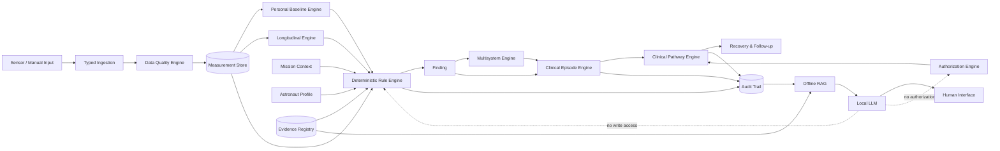

# VIGILE — consolidación biomédica final y especificación computable para Codex

## Resumen ejecutivo

Esta consolidación convierte la investigación de VIGILE en una base suficientemente estructurada para **pasar a implementación en Codex sin realizar otro Deep Research biomédico general**. El alcance exigido procede de la solicitud de consolidación y del encargo biomédico integral anteriores. fileciteturn0file0 fileciteturn0file1

Hay, sin embargo, una limitación de recuperación que debe quedar registrada desde el principio: **los archivos estructurados supuestamente generados por ejecuciones anteriores —incluido el JSON exacto de las 15 reglas— no están presentes como artefactos legibles en esta conversación**. Los dos adjuntos disponibles contienen los requisitos para la investigación, no esos registros. Por tanto, esta entrega **no fingirá haber recuperado literalmente** esos archivos: reconstruye y consolida únicamente aquello que puede verificarse de nuevo contra documentación accesible.

La base normativa principal queda actualizada a octubre de 2026. NASA-STD-3001 Volume 1 continúa activo en **Revision C, 15 de septiembre de 2023**. El índice actual del NASA Technical Standards System identifica **NASA-STD-3001 Volume 2 Revision F, 14 de julio de 2026**, aunque una copia cacheada de la página detallada todavía muestra Revision E; para evitar errores, los requisitos de Volume 2 se citan por identificador y sección oficial, y se marca `NOT_FOUND` cuando no se pudo verificar el número de página exacto del PDF Rev F. citeturn19search0turn19search1turn19search3turn20view0

NASA mantiene además un inventario explícito de riesgos humanos que incluye cardiovascular, VTE, sensorimotor, hueso, inmunidad, SANS, renal, músculo, capacidad aeróbica, sueño/circadiano, nutrición, CO₂, hipoxia, DCS, toxicidad, medicación, EVA, radiación, salud conductual y otros dominios. En paralelo, el Integrated Medical Model de NASA modela **más de 100 condiciones médicas**, incluidas enfermedades comunes, traumatismos y emergencias, lo que justifica que VIGILE no se limite a los riesgos fisiológicos clásicos de microgravedad. citeturn27search5turn21search0turn21search1turn21search2

La conclusión de ingeniería es clara: **Codex ya puede construir el motor**. No todas las condiciones pueden recibir diagnóstico o tratamiento autónomo, pero todas pueden representarse mediante un mismo modelo de episodios, mediciones, evidencia, autorización y seguimiento. Las capacidades sin respaldo suficiente quedan explícitamente bloqueadas mediante `RESEARCH_ONLY`, `REQUIRES_VALIDATION`, `REQUIRES_MISSION_AUTHORIZATION`, `REQUIRES_MEDICAL_AUTHORIZATION`, `NOT_PUBLICLY_AVAILABLE` o `INCONCLUSIVE`.

Los requisitos cuantitativos más sólidos y directamente computables que se recuperaron incluyen:

| Dominio | Criterio verificable | Semántica correcta |
|---|---:|---|
| VO₂max, EVA microgravedad | ≥ 32,9 mL/min/kg | Requisito de capacidad, no diagnóstico. citeturn6view0 |
| VO₂max, EVA superficie extraterrestre | ≥ 36,5 mL/min/kg | Depende del contexto de misión. citeturn5view0 |
| Capacidad aeróbica inflight | ≥ 80 % del preflight | Requiere baseline comparable. citeturn5view0 |
| Fuerza muscular inflight | ≥ 80 % del preflight | Misma prueba/grupo muscular. citeturn6view1 |
| BMD cadera/columna | ≥ 95 % del preflight | Requisito de conservación, no predicción individual de fractura. citeturn6view2 |
| BMD cuello femoral | ≥ 90 % del preflight | Igual limitación. citeturn6view2 |
| Dosis efectiva de radiación | < 600 mSv de carrera | No intercambiar mSv, mGy y mGy-Eq. citeturn6view3 |
| ppCO₂ del hábitat | promedio de 1 h ≤ 3 mmHg | Un pico aislado no equivale a incumplimiento. citeturn19search4turn10search0 |
| Presión habitable | 34,5 kPa < P ≤ 103 kPa | Requisito ambiental, no diagnóstico. citeturn10search0 |
| Ortostatismo | el sistema debe proporcionar contramedidas al pasar de microgravedad a gravedad/Az | No constituye por sí mismo un algoritmo diagnóstico. citeturn19search2 |

La arquitectura clínica debe preservar en todo momento esta cadena:

**dato → calidad → cálculo → requisito/hallazgo → evaluación → hipótesis clínica → triaje autorizado → intervención autorizada → recuperación → seguimiento**

y nunca:

**dato anómalo → diagnóstico automático → tratamiento automático**.

## Catálogo maestro y rutas clínicas

Los registros siguientes constituyen el `MASTER_CONDITION_CATALOG`. Las columnas condensan los campos solicitados sin eliminarlos. `primary_evidence` utiliza los `source_id` que se resuelven en el registro maestro de fuentes más adelante.

**Estados:** `ES = EVIDENCE_SUPPORTED`, `RO = RESEARCH_ONLY`, `RV = REQUIRES_VALIDATION`, `RMA = REQUIRES_MISSION_AUTHORIZATION`, `NPA = NOT_PUBLICLY_AVAILABLE`.

| condition_id | name / specialty | description + relevance_spaceflight | risk_factors / symptoms / signs | biomarkers / sensors / tests | baselines_required / environmental_variables / interactions | primary_evidence | interpretation_limits / authorization_requirements / implementation_state |
|---|---|---|---|---|---|---|---|
| C001 | Capacidad aeróbica reducida / fisiología cardiovascular | Pérdida de rendimiento cardiorrespiratorio que puede comprometer EVA y tareas físicas. | Microgravedad, desacondicionamiento; fatiga y reducción de tolerancia al esfuerzo. | VO₂max/VO₂peak, ergometría, HR. | VO₂ preflight; fase de misión, gravedad, EVA. Interactúa con músculo y CV. | S01, S04. citeturn6view0turn18search3 | Requisitos de rendimiento ≠ enfermedad. `ES`. |
| C002 | Pérdida de tamaño/fuerza/resistencia muscular / muscular | Microgravedad descarga musculatura y puede reducir fuerza y resistencia funcionales. | Desuso, ejercicio insuficiente; debilidad funcional. | Fuerza, dinamometría/ejercicio resistivo, rendimiento funcional. | Baseline por grupo muscular y método; gravedad y programa de ejercicio. | S01, S04. citeturn6view1turn12search3 | No combinar pruebas/grupos incompatibles. `ES`. |
| C003 | Pérdida ósea y riesgo de fractura / óseo | Alteraciones esqueléticas y de resistencia ósea durante exposición a gravedad reducida. | Descarga, duración, nutrición; fractura puede ocurrir sin osteoporosis. | DXA, QCT, BMD, marcadores de recambio cuando disponibles. | DXA preflight; gravedad, ejercicio, nutrición. Interacción renal. | S01, S06. citeturn6view2turn11search7 | BMD por sí sola no predice fractura individual. `ES`. |
| C004 | Desacondicionamiento cardiovascular / cardiovascular | Adaptaciones de circulación, corazón y vasos durante microgravedad. | Microgravedad, duración; menor tolerancia funcional/postural. | HR, BP, ECG, volumen sistólico/cardiaco si disponible, ejercicio. | Baseline CV; gravedad y fase de misión. | S05. citeturn11search0 | No existe un único biomarcador diagnóstico. `RV`. |
| C005 | Intolerancia ortostática / cardiovascular-autonómica | Riesgo principalmente en transición a gravedad/reentrada/aterrizaje. | Desacondicionamiento, cambios hemodinámicos; mareo, presíncope/síncope. | HR, BP beat-to-beat si disponible, test de pie/tilt postflight, síntomas. | Baseline preflight; aplicabilidad condicionada a gravedad. | S02, S05, S34. citeturn19search2turn26search0 | No ejecutar “stand test” en microgravedad como equivalente. Intervención según misión. `RMA`. |
| C006 | Tromboembolismo venoso / cardiovascular-hematológico | Hallazgo emergente de estasis/flujo retrógrado yugular y trombosis durante vuelo. | Alteración de flujo venoso y factores individuales. | Ecografía venosa, síntomas, evaluación clínica. | Anatomía/flujo preflight si disponible; fluid shift. | S35. citeturn27search0 | NASA reportó estasis/flujo reverso en 6/11 y un trombo oclusivo; no derivar de ello umbral diagnóstico automático. `RMA`. |
| C007 | Arritmia/evento cardiovascular agudo / cardiovascular-emergencias | Condición incluida en el espacio de planificación médica de NASA. | Factores personales, fisiología espacial, enfermedad aguda. | ECG, HR, BP, síntomas. | Baseline ECG/historia si autorizado. | S17. citeturn21search0turn21search2 | Protocolo de diagnóstico/tratamiento requiere autoridad médica. `RMA`. |
| C008 | Redistribución de fluidos/hipovolemia relativa / cardiovascular | El cambio gravitatorio altera circulación y contribuye a adaptación CV/ortostática. | Microgravedad, hidratación, retorno a gravedad. | Peso/masa corporal, HR/BP, ultrasonido/hemodinámica según recursos. | Baselines personales; hidratación y gravedad. | S05. citeturn11search0 | No hay umbral operacional único extraído. `RO`. |
| C009 | SANS / neuro-oftalmología | Cambios estructurales oculares y cerebrales relacionados con vuelo prolongado. | Gravedad alterada, susceptibilidad individual; mecanismo incompleto. | Agudeza visual, refracción, fondo de ojo, OCT, IOP cuando disponible. | Evaluación ocular preflight; duración y fluid shift. | S07. citeturn11search2 | NASA señala que no existe equivalente terrestre directo; no diagnosticar por una sola métrica. `RV`. |
| C010 | Space Motion Sickness / neurovestibular | Síntomas durante adaptación a cambios gravitatorios. | Transición gravitatoria; náusea, vómito, mareo, desorientación. | Síntomas, función vestibular, rendimiento. | Susceptibilidad/historia preflight. | S11, S17. citeturn12search2turn21search1 | Tratamiento farmacológico bloqueado sin protocolo autorizado. `RMA`. |
| C011 | Deterioro sensorimotor/postural/locomotor / sensorimotor | Puede afectar marcha, coordinación, control fino y tareas críticas, sobre todo en transiciones G. | Gravedad alterada; desorientación, déficit de coordinación. | Balance, marcha, coordinación, pruebas motoras. | Baseline funcional; fase de transición. | S11. citeturn12search2 | Recuperación puede requerir horas-días; predicción individual no validada. `RV`. |
| C012 | Pérdida de sueño / medicina del sueño | Sueño insuficiente compromete salud y rendimiento cognitivo. | Carga de trabajo, ambiente, horarios, luz, ruido. | Duración/eficiencia, actigrafía, diarios, somnolencia. | Baseline de sueño; luz/ruido/temperatura. | S10. citeturn12search1 | No convertir reducción de sueño en diagnóstico psiquiátrico. `ES`. |
| C013 | Desincronización circadiana / sueño | Horarios irregulares y señales ambientales pueden desalinear ritmos. | Turnos, luz, cambios horarios. | Horario sueño-vigilia, luz, actigrafía; biomarcadores circadianos si disponibles. | Patrón preflight. | S10. citeturn12search1 | Umbrales diagnósticos operacionales `NOT_FOUND`. `RV`. |
| C014 | Fatiga y sobrecarga de trabajo / factores humanos | Carga crónica y sueño insuficiente incrementan riesgo de errores y bajo rendimiento. | Workload, sueño, estrés. | Escalas, sueño, desempeño de tareas. | Baseline individual y de tarea. | S10. citeturn12search1 | No usar una puntuación aislada como incapacidad médica. `RV`. |
| C015 | Deterioro cognitivo funcional / neurocognición | Atención, reacción y decisión pueden verse afectados por sueño, hipoxia, CO₂ y otros factores. | Sueño, fatiga, hipoxia, ambiente, estrés. | Batería cognitiva, tiempo de reacción, precisión. | Baseline repetido con control de aprendizaje. | S10, S14, S27. citeturn12search1turn18search10turn19search4 | Etiología no inferible de una prueba aislada. `RV`. |
| C016 | Cambios conductuales/psiquiátricos / salud conductual | Aislamiento, distancia y otros estresores pueden comprometer bienestar y desempeño. | Aislamiento, estrés, sueño, conflicto. | Cuestionarios autorizados, entrevistas, cambios conductuales. | Baseline conductual cuando sea ético/operacionalmente autorizado. | S12. citeturn18search7 | Datos altamente sensibles; diagnóstico requiere profesional. `RMA`. |
| C017 | Deterioro de trabajo en equipo/adaptación psicosocial / factores humanos | Mala coordinación/comunicación puede afectar seguridad y misión. | Aislamiento, conflicto, carga de trabajo. | Indicadores de equipo, autorreportes, desempeño colectivo. | Perfil de equipo y misión. | S12. citeturn18search7turn27search5 | No patologizar desacuerdos ni inferir estados mentales ocultos. `RO`. |
| C018 | Alteración de respuesta inmunitaria / inmunología | El vuelo espacial altera respuestas inmunes; la magnitud clínica individual sigue incierta. | Microgravedad, estrés, sueño, radiación. | Sangre/saliva/orina, células y mediadores según protocolo. | Baselines inmunológicos longitudinales. | S09. citeturn12search0turn12search7 | Cambio biomarcador ≠ inmunodeficiencia clínica. `RV`. |
| C019 | Reactivación viral latente / infeccioso-inmunológico | Reactivación viral ha sido observada durante vuelo y se relaciona con cambios inmunes. | Estrés e inmunomodulación. | PCR/serología/biomarcadores cuando autorizados; síntomas. | Baseline/historia viral. | S09. citeturn12search0turn12search7 | No diagnosticar reactivación por síntomas inespecíficos. `RV`. |
| C020 | Infección/host–microorganism interaction / infeccioso | Microbiomas y huésped pueden cambiar en el ambiente espacial; infecciones forman parte de condiciones IMM. | Entorno cerrado, microbioma, inmunidad. | Temperatura, síntomas, cultivos/PCR/lab según recursos. | Historia y baseline; calidad aire/agua. | S03, S17. citeturn18search0turn21search1 | Tratamiento antimicrobiano requiere protocolo médico. `RMA`. |
| C021 | Formación de cálculos renales / nefro-urología | Descarga ósea y cambios urinarios pueden elevar riesgo de litiasis. | Hipercalciuria, hidratación, dieta, pérdida ósea. | Orina, química urinaria, ecografía cuando disponible. | Historia renal, orina preflight; hidratación. | S08. citeturn11search3turn21search15 | Herramienta predictiva individual requiere validación. `RV`. |
| C022 | Retención urinaria / urología | Riesgo HSRB explícito y condición relevante en asistencia autónoma. | Medicación, fisiología, obstrucción u otros factores. | Síntomas, volumen vesical/ultrasonido si disponible. | Historia urológica. | S03. citeturn27search5 | Umbrales y procedimientos operacionales públicos insuficientes. `NPA`. |
| C023 | Nutrición/energía inadecuadas / nutrición-metabolismo | Alimentación segura, suficiente y aceptable es necesaria para salud/rendimiento; exploración limita reabastecimiento. | Duración, degradación alimento, ingesta insuficiente, palatabilidad. | Ingesta, masa corporal, paneles bioquímicos cuando disponibles. | Peso, composición corporal, dieta preflight. | S13. citeturn18search2turn18search11 | No generar prescripción dietética clínica sin objetivos autorizados. `ES`. |
| C024 | Deshidratación/desequilibrio hidroelectrolítico / nutrición-renal | Variable transversal relevante a CV, renal y desempeño. | Ingesta insuficiente, pérdidas GI, ejercicio/EVA. | Ingesta/salida, masa, orina y electrolitos si disponibles. | Baselines personales; ambiente/EVA. | S13, S02. citeturn18search2turn18search8 | No se extrajo un umbral NASA único universal. `RV`. |
| C025 | Enfermedad gastrointestinal aguda / gastroenterología | Condiciones GI forman parte del conjunto médico que debe poder manejarse en vuelo. | Infección, dieta, fármacos, adaptación. | Síntomas, hidratación, examen/lab según recursos. | Historia GI. | S17. citeturn21search0turn21search2 | Diagnóstico/tratamiento específico requiere protocolo clínico. `RMA`. |
| C026 | Hipoxia / respiratorio-ambiental | Atmósferas de presión reducida pueden elevar riesgo de hipoxia, especialmente en preparaciones EVA. | ppO₂/presión, protocolos prebreathe. | ppO₂ ambiental, SpO₂, síntomas, rendimiento. | SpO₂ si se usa; presión/atmósfera/suit. | S14, S02. citeturn18search10turn18search8 | NASA continúa estudiando niveles tolerables; no inventar umbral clínico adicional. `RV`. |
| C027 | Exposición nominal/crónica a CO₂ / ambiental-respiratorio-neurológico | CO₂ elevado se asocia con cefalea y otros síntomas y tiene límite ambiental específico. | Ventilación, carga metabólica, acumulación local. | ppCO₂ ambiental continuo, síntomas. | Patrón ambiental; actividad/ventilación. | S02, S27. citeturn19search4turn10search0 | 3 mmHg es límite del promedio horario del hábitat, no umbral diagnóstico individual. `ES`. |
| C028 | Exposición a sustancias tóxicas / toxicología | Fugas, off-gassing, combustión y contaminantes pueden causar efectos agudos/graves. | Fallos ECLSS/payload, humo, químicos, propulsantes. | Sensores ambientales específicos + fisiología/lab según agente. | Concentraciones ambientales normales. | S37. citeturn27search2turn27search7 | Límites son sustancia-específicos; no se ha extraído catálogo completo aquí. `RMA`. |
| C029 | Exposición a polvo celestial/lunar / ocupacional-respiratorio | Polvo externo puede introducirse en vehículos/hábitats de superficie. | EVA y hábitat de superficie. | Monitoreo partículas/exposición, síntomas. | Exposición cero/normal; operaciones EVA. | S03, S37. citeturn27search5turn27search7 | Umbrales operacionales específicos no recuperados. `RV`. |
| C030 | Enfermedad por descompresión / aeroespacial | Burbujas de nitrógeno durante transición de alta a baja presión pueden causar enfermedad y comprometer EVA. | Presión, nitrógeno tisular, prebreathe insuficiente. | Presión/suit, síntomas clínicos, exposición. | Perfil presión/respiración. | S36. citeturn27search1turn27search4 | Protocolos detallados de misión deben ser autorizados; fracción de gravedad añade incertidumbre. `RMA`. |
| C031 | Barotrauma/ear-sinus block / ORL | Condición ambiental incluida en IMM para cambios de presión. | Cambios de presión. | Síntomas, examen otológico si disponible, presión. | Historia ORL. | S17. citeturn21search0turn21search1 | Protocolo específico no extraído. `RMA`. |
| C032 | Exposición acumulada a radiación ionizante/carcinogénesis / radiobiología | Riesgo de cáncer y otros efectos obliga a seguimiento dosimétrico. | GCR/SPE/duración/escudo. | Dosimetría efectiva y órgano-específica. | Dosis acumulada previa; entorno de radiación. | S01, S16. citeturn6view3turn18search9 | Dosis ≠ diagnóstico de cáncer; conversiones dosimétricas deben ser válidas. `ES`. |
| C033 | Síndrome/efectos agudos de radiación / emergencias-radiobiología | IMM contempla radiation sickness para planificación médica. | Evento radiológico suficientemente intenso. | Dosimetría, síntomas, hematología según protocolo. | Dosis previa y evento. | S17, S01. citeturn21search1turn6view3 | Umbrales clínicos detallados no extraídos; intervención bloqueada. `RMA`. |
| C034 | Radiación no ionizante / ambiental | HSRB mantiene riesgo específico por NIR. | Fuentes electromagnéticas/ópticas según misión. | Dosimetría/monitorización específica a fuente. | Exposición nominal. | S03. citeturn27search5 | Límites específicos no recuperados. `RV`. |
| C035 | Pérdida auditiva/exposición acústica / audiología | Ruido puede afectar audición, sueño, comunicación y desempeño. | SPL, duración, frecuencias. | Dosimetría acústica, audiometría/hearing test. | Audiograma preflight; ambiente acústico. | S38, S02. citeturn27search3turn27search6 | Límite ambiental no equivale a diagnóstico de pérdida auditiva. `ES`. |
| C036 | Lesión por cargas dinámicas / trauma | Lanzamiento/aterrizaje y cargas pueden lesionar. | Aceleraciones, impacto, postura. | Acelerometría + evaluación clínica. | Perfil misión y antropometría. | S03. citeturn27search5 | Diagnóstico de lesión requiere evaluación. `RMA`. |
| C037 | Lesión/rendimiento comprometido durante EVA / medicina EVA | EVA combina carga física, suit, DCS, hipoxia, CO₂ y fatiga. | Suit, duración, ambiente, carga de trabajo. | Suit telemetry, HR, gases, síntomas/rendimiento. | Baseline funcional y perfil EVA. | S03. citeturn18search0 | Triaje e interrupción se rigen por reglas de misión. `RMA`. |
| C038 | Trauma, heridas y fractura aguda / emergencias | El modelo médico NASA contempla abrasiones, laceraciones, quemaduras, esguinces, fracturas y lesiones craneales. | EVA, mantenimiento, cargas, accidente. | Evaluación clínica, imagen/ultrasonido según capacidad. | Historia/función baseline. | S17. citeturn21search0 | Procedimientos invasivos y analgesia requieren autorización. `RMA`. |
| C039 | Patología/emergencia dental / odontología | IMM utiliza historia dental y contempla daño, caries/abscesos. | Restauraciones previas, trauma, enfermedad dental. | Historia, examen/imágenes según recursos. | Evaluación dental preflight. | S17, S19. citeturn21search0turn21search4 | Contenido operacional completo de tratamiento no consolidado. `RMA`. |
| C040 | Medicamento ineficaz o tóxico / farmacología | Estabilidad, reabastecimiento y fisiología espacial pueden alterar eficacia/toxicidad; PK/PD puede diferir. | Duración, almacenamiento, cambios fisiológicos, interacción. | Inventario, lote/caducidad/condiciones, respuesta clínica. | Medicación previa, ambiente de almacenamiento. | S15. citeturn18search5 | VIGILE no calcula dosis nuevas ni prescribe. `RMA`. |
| C041 | Infección respiratoria/inhalación de humo / respiratorio-emergencias | IMM incluye infecciones respiratorias y smoke inhalation; ambiente cerrado amplifica exposición. | Infección, combustión, contaminantes. | SpO₂, síntomas, ambiente, examen/lab. | Respiratorio preflight; aire ambiental. | S17, S37. citeturn21search1turn27search2 | Diagnóstico y tratamiento requieren supervisión. `RMA`. |
| C042 | Choque eléctrico / emergencias | HSRB mantiene riesgo explícito de daño eléctrico. | Fallos/energía/mantenimiento. | Evento eléctrico + evaluación fisiológica/ECG cuando corresponda. | Contexto técnico. | S03. citeturn27search5 | Protocolo médico operacional específico `NPA`. |
| C043 | Incapacidad de egress/tarea tras transición de gravedad / rendimiento | Readaptación sensorimotora/ortostática puede comprometer aterrizaje, salida y tareas críticas. | Retorno a gravedad, desacondicionamiento. | Marcha, balance, HR/BP, capacidad funcional. | Preflight + fase de transición. | S03, S11, S02. citeturn27search5turn12search2turn19search2 | “Fit for task” necesita regla de misión. `RMA`. |
| C044 | Alteración dermatológica/infección cutánea / dermatología-inmunología | Rashes e infecciones cutáneas aparecen dentro del espectro inmunológico/médico relevante. | Inmunidad, ambiente cerrado, humedad/contacto. | Inspección/imágenes clínicas, síntomas, microbiología si disponible. | Estado cutáneo preflight. | S09, S17. citeturn12search7turn21search0 | Clasificación automatizada por imagen necesitaría validación específica. `RV`. |

El catálogo está deliberadamente construido como **condiciones/riesgos computables**, no como una lista de “diagnósticos que VIGILE puede realizar”. NASA distingue riesgos humanos de condiciones clínicas; el IMM, por ejemplo, utiliza más de cien condiciones para planificación probabilística y recursos, pero presupone en algunos usos históricos que las condiciones se diagnostican y tratan correctamente, lo que impide interpretar sus salidas como validación de un sistema diagnóstico autónomo. citeturn21search0turn21search4turn21search17

**Modelo común de `COMPLETE_CLINICAL_PATHWAY`.**

```json
{
  "condition_id": "Cxxx",
  "stages": {
    "prevention": {
      "inputs": [],
      "measurements": [],
      "algorithm": null,
      "decision_logic": "",
      "output": "",
      "sources": [],
      "validation_state": "EVIDENCE_SUPPORTED"
    },
    "monitoring": {},
    "data_quality": {},
    "detection": {},
    "assessment": {},
    "differential_diagnosis": {},
    "triage": {},
    "intervention_authorized": {},
    "recovery": {},
    "follow_up": {},
    "prognosis": {}
  }
}
```

Los outputs estándar serán `NO_FINDING`, `FINDING`, `REQUIREMENT_MET`, `REQUIREMENT_NOT_MET`, `INCONCLUSIVE`, `ASSESSMENT_REQUIRED`, `HUMAN_MEDICAL_REVIEW_REQUIRED`, `AUTHORIZED_PROTOCOL_AVAILABLE` y `BLOCKED_NO_AUTHORIZATION`. Esto es una **decisión de ingeniería**, no nomenclatura NASA.

La siguiente tabla contiene una ruta para **cada uno de los 44 registros**. `P/M/Q/D/A/DD/T/I/R/F/G` significa prevención, monitoring, data quality, detection, assessment, differential diagnosis, triage, intervention, recovery, follow-up y prognosis.

| ID | pathway_profile |
|---|---|
| C001 | **P:** programa de contramedidas autorizado `[ES:S04]`; **M:** VO₂max comparable `[ES:S01]`; **Q:** validar unidad/método/baseline/contexto EVA; **D:** aplicar 32,9/36,5 y 80 % solo donde corresponda `[ES:S01]`; **A:** revisar síntomas/rendimiento; **DD:** causas no espaciales y multisistema `[RV]`; **T:** misión/humano; **I:** ejercicio autorizado, no prescripción generada `[RMA]`; **R:** objetivo de reacondicionamiento hacia preflight `[ES:S01]`; **F:** tendencia longitudinal; **G:** `INCONCLUSIVE` para predicción clínica individual. |
| C002 | **P:** ejercicio resistivo `[ES]`; **M:** fuerza mismo grupo/método; **Q:** impedir comparación heterogénea; **D:** ratio actual/preflight y requisito 80 % `[S01]`; **A/DD:** lesión, dolor, nutrición, neurológico; **T:** human review si deterioro funcional; **I:** plan autorizado; **R:** retornar hacia baseline `[S01]`; **F:** repetir prueba; **G:** sin predictor validado. |
| C003 | **P:** ejercicio/nutrición/contramedidas autorizadas; **M:** DXA/QCT cuando programado; **Q:** región y tecnología coherentes; **D:** conservación 95/95/90 % `[S01]`; **A:** integrar fractura/riesgo, no solo BMD; **DD:** causas metabólicas/trauma; **T/I:** médico; **R:** reacondicionamiento hacia baseline; **F:** vigilancia postflight; **G:** no inferir fractura individual únicamente de DXA. |
| C004 | **P:** ejercicio y gestión de misión; **M:** HR/BP/rendimiento; **Q:** postura, gravedad, actividad, sensor; **D:** tendencia vs baseline sin umbral diagnóstico `[RV]`; **A:** evaluación CV; **DD:** volumen, ritmo, sueño, enfermedad; **T/I:** autorización médica; **R/F:** tendencia postflight; **G:** research-only. |
| C005 | **P:** contramedidas de transición a gravedad `[S02]`; **M:** síntomas+HR/BP bajo protocolo; **Q:** prohibir extrapolación de prueba postflight a microgravedad; **D:** desviaciones según protocolo autorizado; **A:** stand/tilt solo contexto válido; **DD:** hipovolemia, arritmia, neurológico; **T:** misión; **I:** compresión/u otras contramedidas solo autorizadas; **R/F:** reevaluar en gravedad; **G:** no predictor autónomo. |
| C006 | **P:** configuración médica de misión; **M:** síntomas/ultrasonido si indicado; **Q:** adquisición ecográfica adecuada; **D:** no regla automática basada en flujo aislado; **A:** revisión médica; **DD:** variantes anatómicas/compresión/artefacto; **T:** `HUMAN_MEDICAL_REVIEW_REQUIRED`; **I:** bloqueado sin médico; **R/F/G:** protocolo autorizado, pronóstico no automatizado. |
| C007 | **P:** selección/baseline; **M:** ECG/HR/BP/síntomas; **Q:** señal ECG; **D:** algoritmos de dispositivo validados únicamente; **A/DD/T:** médico; **I:** bloqueado salvo protocolo de emergencia; **R/F:** registro episodio; **G:** IMM puede informar planificación, no diagnóstico. |
| C008 | **P:** hidratación/contramedidas configuradas; **M:** hemodinámica; **Q:** postura/gravedad; **D:** tendencias `[RO]`; **A/DD:** causas de volumen; **T/I:** humano; **R/F:** volver al baseline; **G:** research-only. |
| C009 | **P:** contramedidas aún en investigación; **M:** visión/OCT/fondo/IOP según disponibilidad; **Q:** mismo equipo/protocolo; **D:** cambio longitudinal; **A:** neuro-oftalmología; **DD:** patología ocular/neurológica terrestre; **T:** pérdida visual aguda → protocolo médico; **I:** bloqueado salvo autorización; **R/F:** seguimiento longitudinal; **G:** no pronóstico validado. |
| C010 | **P:** entrenamiento/plan de adaptación; **M:** síntomas/rendimiento; **Q:** fase gravitatoria; **D:** cuestionario/protocolo autorizado; **A/DD:** vestibular vs GI/neurológico; **T:** según impacto funcional; **I:** medicación solo autorizada; **R/F:** adaptación y recurrencia; **G:** individualización `RV`. |
| C011 | **P:** contramedidas/entrenamiento; **M:** balance/marcha/coordinación; **Q:** superficie/gravedad/protocolo; **D:** cambio vs baseline; **A:** funcional; **DD:** ortostático, neurológico, lesión; **T:** task-safety review; **I:** rehabilitación autorizada; **R/F:** readaptación; **G:** no extrapolar plazo individual. |
| C012 | **P:** horario/luz/ambiente; **M:** duración/eficiencia/diario; **Q:** wear time y ventanas válidas; **D:** desviación personal, no diagnóstico; **A/DD:** carga, ruido, circadiano, salud mental; **T:** por deterioro funcional; **I:** contramedidas autorizadas; **R/F:** retorno al patrón; **G:** tendencia, no diagnóstico. |
| C013 | **P:** planificación circadiana; **M:** sueño-vigilia/luz; **Q:** sincronización temporal; **D:** desfase según algoritmo de misión `[RV]`; **A/DD:** horarios/sueño; **T/I:** autorización; **R/F:** realineamiento; **G:** research-only. |
| C014 | **P:** límites de carga programáticos; **M:** workload+sueño+rendimiento; **Q:** escalas completas y temporalmente alineadas; **D:** combinación multivariable `[RV]`; **A/DD:** sueño, enfermedad, estrés; **T:** riesgo operacional; **I:** reajuste autorizado; **R/F:** desempeño; **G:** sin predictor universal. |
| C015 | **P:** sueño/ambiente/carga; **M:** batería cognitiva; **Q:** práctica, versión, latencia de dispositivo; **D:** cambio robusto vs baseline; **A/DD:** sueño, CO₂, hipoxia, estrés, medicación; **T:** desempeño crítico; **I:** tratar causa solo si identificada/autorizada; **R/F:** reevaluación; **G:** research-only. |
| C016 | **P:** apoyo conductual/privacidad; **M:** instrumentos autorizados; **Q:** confidencialidad y validez; **D:** señales predefinidas, no inferencia LLM; **A/DD:** profesional; **T:** protocolo médico; **I:** bloqueado sin autoridad; **R/F:** seguimiento confidencial; **G:** no scoring autónomo de pronóstico. |
| C017 | **P:** selección/entrenamiento de equipo; **M:** desempeño/comunicación; **Q:** evitar vigilancia invasiva no autorizada; **D:** patrones de misión; **A:** factores humanos; **DD:** no patologizar; **T/I:** organizational support; **R/F:** resiliencia del equipo; **G:** research-only. |
| C018 | **P:** sueño/nutrición/mitigación de estrés; **M:** biomarcadores autorizados; **Q:** muestra, lote, timing; **D:** cambio longitudinal `[RV]`; **A/DD:** infección, estrés, variabilidad; **T/I:** médico; **R/F:** biomarcadores+clínica; **G:** no pronóstico clínico autónomo. |
| C019 | **P:** control de factores de estrés; **M:** síntomas+ensayos si disponibles; **Q:** calidad PCR/serología; **D:** laboratorio, no síntomas solos; **A/DD:** otras infecciones; **T/I:** médico; **R/F:** resolución; **G:** `RV`. |
| C020 | **P:** higiene/aire/agua/contención; **M:** síntomas+ambiente; **Q:** muestra/sensor; **D:** screening autorizado; **A/DD:** etiología infecciosa vs ambiental; **T:** médico; **I:** antimicrobianos bloqueados sin protocolo; **R/F:** respuesta/recurrencia; **G:** no modelo causal individual. |
| C021 | **P:** hidratación/dieta/contramedidas de misión; **M:** química urinaria/síntomas; **Q:** colección y volumen; **D:** algoritmo probabilístico solo modo investigación; **A/DD:** cólico, UTI, GI; **T/I:** médico; **R/F:** recurrencia/química; **G:** RSFM solo si validado para misión. |
| C022 | **P:** revisión de riesgo; **M:** síntomas/volumen vesical; **Q:** ultrasonido si utilizado; **D:** reglas clínicas `NPA`; **A/DD/T/I:** médico; **R/F:** vaciamiento/recurrencia; **G:** no disponible. |
| C023 | **P:** menú nutricional seguro/adecuado; **M:** ingesta, masa, paneles; **Q:** completitud de registro; **D:** objetivos de misión; **A/DD:** enfermedad, absorción, preferencias; **T/I:** nutricionista/médico según gravedad; **R/F:** balance longitudinal; **G:** modelos de reservas solo validados. |
| C024 | **P:** plan hídrico; **M:** ingesta/salida, masa, orina; **Q:** sincronizar pérdidas/consumo; **D:** thresholds `NOT_FOUND` salvo protocolo; **A/DD:** GI, renal, EVA; **T/I:** médico; **R/F:** retorno a estado personal; **G:** `RV`. |
| C025 | **P:** higiene/food safety; **M:** síntomas/hidratación; **Q:** timing y gravedad; **D:** screening; **A/DD:** infección, adaptación, fármaco, abdomen agudo; **T/I:** médico; **R/F:** tolerancia oral/síntomas; **G:** no autónomo. |
| C026 | **P:** control atmósfera/protocolo EVA; **M:** ppO₂/SpO₂/síntomas; **Q:** calibración/contexto presión; **D:** límites ambientales configurados, no umbral clínico inventado; **A/DD:** respiratorio, CO₂, perfusión; **T/I:** protocolo de misión; **R/F:** normalización; **G:** tolerancia individual `RV`. |
| C027 | **P:** ventilación/ECLSS; **M:** ppCO₂ continuo; **Q:** cobertura suficiente de ventana; **D:** promedio temporal 1 h >3 mmHg → `REQUIREMENT_NOT_MET`; **A/DD:** síntomas y fluid shift pueden confundir; **T:** alerta ambiental; **I:** acción de vehículo según autoridad, clínica si sintomático; **R/F:** comprobar descenso; **G:** no diagnosticar hipercapnia clínica solo por ambiente. |
| C028 | **P:** materiales/monitorización/contención; **M:** detector específico; **Q:** compuesto/calibración; **D:** límite específico de misión; **A/DD:** inhalación/dermal/ocular; **T:** emergencia; **I:** scrubber/PPE y medicina solo por protocolo; **R/F:** vigilancia; **G:** toxicante-específico. |
| C029 | **P:** exclusión/mitigación de polvo; **M:** partículas/exposición; **Q:** sensor/ubicación; **D:** regla mission-specific; **A/DD:** irritación, toxicidad, infección; **T/I:** misión; **R/F:** síntomas/exposición acumulada; **G:** `RV`. |
| C030 | **P:** prebreathe/atmósfera/suit autorizado; **M:** perfil presión + síntomas; **Q:** cronología de presión; **D:** DCS sospechada requiere evaluación; **A/DD:** trauma, hipoxia, barotrauma; **T:** finalizar EVA de forma segura según protocolo; **I:** misión/médico; **R/F:** vigilancia postevento; **G:** gravedad parcial incierta. |
| C031 | **P:** perfiles de presión; **M:** síntomas+presión; **Q:** cronología; **D:** screening; **A/DD:** DCS/ORL; **T/I:** médico; **R/F:** resolución; **G:** `NPA`. |
| C032 | **P:** ALARA y shielding; **M:** dosimetría; **Q:** tipo de dosis/unidad/órgano; **D:** acumulación vs límites; **A:** exposición, no cáncer; **DD:** N/A para cumplimiento; **T:** evento radiológico separado; **I:** reducción de exposición según misión; **R/F:** vigilancia de carrera; **G:** modelos de riesgo independientes. |
| C033 | **P:** monitoring/SPE shelter; **M:** dosis + clínica; **Q:** dosimetría compatible; **D:** thresholds ARS no consolidados aquí; **A/DD/T/I:** protocolo médico; **R/F:** hematología/órganos; **G:** blocked. |
| C034 | **P:** control de fuentes; **M:** exposición; **Q:** frecuencia/espectro; **D:** límites específicos no consolidados; **A/DD/T/I:** misión/médico; **R/F:** exposición; **G:** `RV`. |
| C035 | **P:** diseño acústico; **M:** SPL/dosis+audiometría; **Q:** calibración/frecuencia/duración; **D:** incumplimiento ambiental separado de pérdida auditiva; **A/DD:** audiología; **T/I:** misión/médico; **R/F:** hearing surveillance; **G:** daño individual no deducible únicamente de SPL. |
| C036 | **P:** diseño/restricción de cargas; **M:** aceleración/evento; **Q:** sensor y orientación; **D:** evento sobre límites → ingeniería + evaluación, no diagnóstico; **A/DD/T/I:** trauma protocol; **R/F:** función; **G:** no autónomo. |
| C037 | **P:** preparación EVA; **M:** suit+biomed; **Q:** tiempo y sensor sincronizados; **D:** reglas de EVA; **A/DD:** DCS/hipoxia/CO₂/lesión; **T/I:** mission control/onboard authority; **R/F:** post-EVA; **G:** task performance. |
| C038 | **P:** safety; **M:** evento/síntomas; **Q:** mecanismo y tiempos; **D:** injury screening; **A/DD:** protocolo de trauma; **T/I:** autoridad médica; **R:** funcional; **F:** herida/dolor/función; **G:** outcome model solo si validado. |
| C039 | **P:** dental clearance; **M:** dolor/lesión; **Q:** documentación; **D:** screening; **A/DD:** caries, absceso, trauma; **T/I:** médico/dental autorizado; **R/F:** dolor/infección/función; **G:** no automático. |
| C040 | **P:** inventario/estabilidad; **M:** lote, caducidad, storage, respuesta; **Q:** identidad/dosis prescrita sin alterarla; **D:** flag de almacenamiento/caducidad o respuesta atípica; **A/DD:** enfermedad vs fármaco; **T:** médico; **I:** VIGILE jamás crea dosis; **R/F:** eficacia/eventos adversos; **G:** PK/PD espacial `RV`. |
| C041 | **P:** control infección/humo; **M:** síntomas, SpO₂, atmósfera; **Q:** sensor/exposición; **D:** screening; **A/DD:** infección, toxicidad, hipoxia; **T/I:** médico/emergencia; **R/F:** respiratorio; **G:** no automático. |
| C042 | **P:** electrical safety; **M:** evento; **Q:** verificar exposición; **D:** cualquier evento relevante activa protocolo de seguridad; **A/DD/T/I:** médico + engineering; **R/F:** seguimiento; **G:** `NPA`. |
| C043 | **P:** countermeasures/readaptation; **M:** función+ortostatismo+sensorimotor; **Q:** gravedad/tarea; **D:** task-specific gate; **A/DD:** CV/sensorimotor/músculo; **T:** no autorizar tarea si regla de misión falla; **I:** rehabilitation/countermeasure; **R/F:** re-test; **G:** misión-específico. |
| C044 | **P:** higiene/protección; **M:** piel/síntomas; **Q:** imagen/iluminación si utilizada; **D:** cambio sospechoso; **A/DD:** dermatitis, infección, trauma; **T/I:** médico; **R/F:** cicatrización/recurrencia; **G:** visión artificial `RV`. |

Estas rutas implementan un principio respaldado por el trabajo de Exploration Medical Capability: para exploración hay que identificar condiciones, decidir cuáles pueden tratarse dentro del entorno y traducirlas a capacidades, recursos y autonomía; no basta con trasladar la atención médica terrestre sin considerar las limitaciones de masa, energía, comunicación y evacuación. citeturn21search13turn21search18turn17search7

## Biblioteca de algoritmos, sensores e interacciones

**`BIOMEDICAL_ALGORITHM_LIBRARY`**

| algorithm_id | purpose | equations / inputs / outputs | parameters & assumptions | validation_status / test cases |
|---|---|---|---|---|
| ALG001 | Baseline personal robusto | mediana \(m=\mathrm{median}(x_i)\); MAD \(=\mathrm{median}(|x_i-m|)\). Inputs: mediciones preflight comparables. Output: baseline + dispersión. | No mezclar métodos/unidades/contextos. Número mínimo de observaciones = configuración del protocolo, no inventarlo. | Método estadístico `ENGINEERING_CHOICE`; MAD documentado por NIST. citeturn16search3 |
| ALG002 | Retención respecto a baseline | \(R=100\times x_{actual}/x_{baseline}\). | Baseline >0, misma variable/método/unidad. | Fórmula de ingeniería que implementa requisitos de conservación NASA para aerobic/muscle/bone. citeturn6view1turn6view2 |
| ALG003 | Promedio temporal ponderado | \(\bar x_T=\sum_i x_i\Delta t_i/\sum_i\Delta t_i\). | Cobertura temporal válida; no sustituir muestras faltantes silenciosamente. | Necesario para V2 6004, promedio de 1 h de ppCO₂. citeturn19search4 |
| ALG004 | Tendencia longitudinal | regresión \(x_t=\beta_0+\beta_1t+\epsilon\); salida pendiente + incertidumbre. | No asumir causalidad; comparar fase/contexto. | `ENGINEERING_CHOICE`; NASA exige conservar registros para análisis de tendencias. citeturn5view4 |
| ALG005 | EWMA | \(z_t=\lambda x_t+(1-\lambda)z_{t-1}\). | \(\lambda\) configurable; no convertir valores estadísticos por defecto en umbrales médicos. | Técnica SPC, no criterio clínico NASA. citeturn16search0 |
| ALG006 | Z-score / robust z | \(z=(x-\mu)/s\); robusto \(z_r=0.6745(x-\mathrm{median})/MAD\). | Solo distribución/contexto apropiados. | `ENGINEERING_CHOICE`; fórmula NIST. citeturn16search2turn16search3 |
| ALG007 | CUSUM para cambio persistente | acumulación de desviaciones positivas/negativas respecto a objetivo. | Referencia y decisión configurables; no usar parámetros genéricos clínicamente. | Técnica de detección estadística; NIST. citeturn16search1 |
| ALG008 | Fusión multisensor conservadora | combina únicamente observaciones temporalmente compatibles y con calidad válida; discrepancia → `CONFLICTING_DATA`. | Sin pesos clínicos hasta validación; provenance obligatorio. | `ENGINEERING_CHOICE`, `REQUIRES_VALIDATION`. |
| ALG009 | Política de missing data | ningún imputado para reglas normativas salvo que la propia regla lo permita; input obligatorio ausente → `INCONCLUSIVE`. | Diferenciar `MISSING`, `NOT_MEASURED`, `INVALID`, `STALE`. | `ENGINEERING_CHOICE`; diseñado para evitar falsa certeza. |
| ALG010 | Normalización dimensional | conversión solo entre unidades dimensionalmente equivalentes y conversiones registradas. | mSv, mGy, mGy-Eq no intercambiables sin modelo dosimétrico. | `ENGINEERING_CHOICE` + requisito de preservar semántica de radiación. citeturn6view3 |
| ALG011 | Quality gate | validación de sensor → rango técnico → timestamp → calibración → contexto → completitud. | Umbrales de calidad solo si provienen del dispositivo/protocolo. | `ENGINEERING_CHOICE`; no inventar 90/95 % de calidad. |
| ALG012 | Máquina de estados de episodio | `MONITORING→FINDING→ASSESSMENT→TRIAGE→AUTHORIZED_ACTION→RECOVERY→FOLLOW_UP→CLOSED`. | Transición terapéutica requiere `authorization_token`. | Arquitectura `ENGINEERING_CHOICE`; apropiada para autonomía médica restringida. |

Pseudocódigo implementable:

```text
function evaluate_measurement(m):
    validate_schema(m)
    normalize_units_if_safe(m)
    quality = quality_gate(m)

    if quality != VALID:
        return INCONCLUSIVE(reason=quality)

    store_immutable(m)

    for rule in applicable_rules(m.subject, m.mission_context):
        required = fetch_inputs(rule)

        if missing_required(required):
            emit(rule, INCONCLUSIVE, reason="MISSING_REQUIRED_INPUT")
            continue

        if incompatible_units(required):
            emit(rule, INCONCLUSIVE, reason="DIMENSIONAL_MISMATCH")
            continue

        result = rule.evaluate(required)

        emit(
            result=result,
            evidence_refs=rule.evidence_refs,
            rule_version=rule.version,
            inputs_hash=hash(required)
        )

        if result.requires_assessment:
            open_or_update_clinical_episode(result)
```

```text
function robust_baseline(values):
    valid = [x for x in values if x.quality == VALID and comparable_context(x)]
    if insufficient_by_protocol(valid):
        return INCONCLUSIVE

    median = MEDIAN(valid)
    mad = MEDIAN(abs(valid - median))
    return {location: median, dispersion: mad}
```

```text
function time_weighted_average(samples, start, end):
    samples = valid_samples_covering(samples, start, end)

    if not coverage_sufficient_by_rule(samples):
        return INCONCLUSIVE

    area = integrate_piecewise(samples, start, end)
    return area / (end - start)
```

```text
function fuse_findings(findings):
    valid = reject_invalid_or_stale(findings)

    if contradictory_high_quality_findings(valid):
        return CONFLICTING_DATA

    # No probabilistic weights are invented.
    return deterministic_compound_rules(valid)
```

**`SENSOR_AND_BIOMARKER_REGISTRY`**

`frequency=MISSION_DEFINED` significa que no se halló una cadencia universal pública y, por tanto, Codex no debe inventarla.

| variable | units | sensor_type/test | frequency | space_viability | quality_requirements / artifacts | baseline |
|---|---|---|---|---|---|---|
| VO₂max | mL/min/kg | ergoespirometría/directa o método indirecto autorizado | MISSION_DEFINED | Demostrada como variable operativa | mismo método/contexto; ejercicio y motivación confunden | Sí |
| Fuerza muscular | N, kgf o múltiplo BW según test | dinamometría/equipo resistivo | MISSION_DEFINED | Alta | mismo ejercicio, grupo y técnica | Sí |
| BMD cadera | g/cm² / porcentaje baseline | DXA | pre/post según programa | Principalmente ground | posicionamiento/equipo/región | Sí |
| BMD columna L1-L4 | g/cm² | DXA | programada | Principalmente ground | igual | Sí |
| BMD cuello femoral | g/cm² | DXA | programada | Principalmente ground | igual | Sí |
| QCT óseo | volumétrica según protocolo | CT/QCT | programada | Ground; implementación vigilancia en evolución | mismo protocolo/segmentación | Sí |
| Dosis efectiva | mSv | dosímetro/modelo dosimétrico | continua/acumulativa | Alta | provenance y conversión | Dosis acumulada |
| Dosis órgano | mGy o mGy-Eq según requisito | dosimetría | exposición/evento | Alta | nunca mezclar magnitudes | Historial |
| ppCO₂ | mmHg | monitor ambiental | continuo | Requerida | calibración, ubicación, cobertura temporal | No clínico |
| ppO₂ | kPa/mmHg según sistema | monitor ambiental | continuo | Requerida | presión total/contexto | No |
| Presión cabina | kPa/psia | sensor atmosférico | continuo | Requerida | calibración/compartimento | No |
| Temperatura | °C | ambiental | continuo | Requerida | ubicación | No |
| Humedad relativa | % | ambiental | continuo | Requerida | sensor/condensación | No |
| Frecuencia cardiaca | bpm | ECG/PPG | continuo o protocolo | Alta | movimiento/PPG perfusión | Sí |
| ECG | mV / ritmo | electrodos | evento/protocolo | Alta | artefacto movimiento/contacto | Sí |
| Presión arterial | mmHg | cuff/beat-to-beat según protocolo | MISSION_DEFINED | Alta | postura, gravedad, cuff | Sí |
| SpO₂ | % | oximetría | evento/protocolo | Alta | movimiento/perfusión | Deseable |
| Sueño | min/h, eficiencia | actigrafía + diario | longitudinal | Alta | wear time/actividad/algoritmo | Sí |
| Cognición | tiempo/precisión | test digital validado | programada | Alta | práctica, versión, dispositivo | Sí |
| Agudeza visual/refracción | unidades específicas | optometría | programada | Alta | protocolo consistente | Sí |
| Retina/nervio óptico | μm/imágenes | OCT/fondo | programada | Dependiente hardware | alineación/segmentación | Sí |
| IOP | mmHg | tonometría | MISSION_DEFINED | Dependiente hardware | método/posición | Sí |
| Flujo yugular | velocidad/dirección | ultrasound | indicado/investigación | Demostrada en vuelo | operador/ángulo/respiración | Preferible |
| Volumen vesical/riñón | mL/imagen | ultrasound | indicado | Ultrasound usado en ISS | operador/segmentación | Opcional |
| Química urinaria | analito-específica | laboratorio | protocolo | Dependiente capacidad | colección, tiempo, volumen | Sí |
| Biomarcadores inmunes | analito-específica | sangre/saliva/orina | investigación/protocolo | Muestreo demostrado | preanalítica, lote, storage | Sí |
| Ruido | dBA/SPL/frecuencia | dosímetro acústico | continuo/periodic | Alta | calibración/frecuencia/ubicación | Ambiental |
| Exposición tóxica | agente-específica | detector ambiental | continuo/evento | Agente-dependiente | calibración/cross-sensitivity | Ambiental |

NASA Volume 2 exige monitorización, registro, visualización y/o alertas para parámetros atmosféricos en diversos requisitos; también identifica tendencias de atmósfera, temperatura, humedad, acústica, radiación, cargas dinámicas y datos de traje como relevantes para anticipar y resolver condiciones dañinas. citeturn27search6turn19search6 NASA describe asimismo uso de ultrasound en soporte médico de ISS y monitorización de biomarcadores mediante sangre, saliva y orina en investigación inmunológica. citeturn17search1turn12search7

**`MULTISYSTEM_INTERACTION_MATRIX`**

| interaction_id | systems | evidence / direction | implication_for_VIGILE |
|---|---|---|---|
| MSI01 | Sueño ↔ cognición/rendimiento | Sueño insuficiente/circadiano se relaciona con deterioro de rendimiento y errores. citeturn12search1 | Hallazgo cognitivo debe consultar sueño antes de inferir patología neurológica. |
| MSI02 | Sueño/estrés ↔ inmunidad/reactivación viral | NASA identifica sueño y otros estresores entre factores relacionados con cambios inmunes/reactivación. citeturn12search7 | Co-ocurrencia aumenta prioridad de evaluación; no prueba causalidad individual. |
| MSI03 | Microgravedad/CV ↔ ortostatismo | Cambios cardiovasculares en microgravedad contribuyen a dificultad en retorno a gravedad. citeturn11search0turn19search2 | Contexto de gravedad es input obligatorio. |
| MSI04 | Hueso ↔ riñón | Pérdida ósea incrementa calcio circulante y es relevante para riesgo de cálculo renal. citeturn11search3turn21search15 | Compartir BMD/biomarcadores/calcio con módulo renal, sin diagnóstico automático. |
| MSI05 | Ejercicio ↔ aeróbico/músculo/hueso/CV | Ejercicio es contramedida central para múltiples sistemas. citeturn18search3 | Un único registro de ejercicio debe alimentar varios módulos. |
| MSI06 | CO₂ ↔ cefalea/cognición ↔ fluid shift | NASA documenta asociación de CO₂ con cefalea y advierte que adaptación/fluid shift pueden producir síntomas similares. citeturn19search4 | No atribuir cefalea automáticamente a CO₂; mostrar exposición + confusores. |
| MSI07 | Nutrición ↔ músculo/hueso/inmunidad/rendimiento | Nutrición adecuada es esencial para salud y rendimiento y está integrada con múltiples respuestas fisiológicas. citeturn18search2turn18search11 | Nutritional context acompaña interpretación longitudinal. |
| MSI08 | SANS ↔ gravedad/fluid shift | SANS incluye cambios ojo/cerebro asociados al vuelo; mecanismo exacto sigue incompleto. citeturn11search2 | Marcar asociaciones como hipótesis; prohibir regla causal simple. |
| MSI09 | EVA ↔ DCS/hipoxia/CO₂/fatiga/lesión | NASA identifica simultáneamente estos riesgos en EVA. citeturn18search0turn27search1 | Crear `EVA_CONTEXT` que active conjunto de reglas y sensores. |
| MSI10 | Medicación ↔ fisiología/almacenamiento | PK/PD, estabilidad y ambiente pueden alterar eficacia/toxicidad. citeturn18search5 | Medication engine sólo verifica protocolo/inventario; no inventa dosis. |
| MSI11 | Sensorimotor ↔ egress/task performance | Adaptación gravitatoria puede afectar marcha, coordinación, conducción/egress. citeturn12search2turn27search5 | Gates de tarea deben combinar función sensorimotora y CV. |
| MSI12 | Tóxicos ↔ CV/respiratorio/neurológico/conductual | El DAG NASA de toxicidad describe múltiples vías orgánicas y necesidad de monitoring fisiológico + ambiental. citeturn27search7 | En una exposición, VIGILE debe abrir episodio multisistema, no silo toxicológico. |

## Registro de fuentes y extracciones primarias

**`MASTER_SOURCE_REGISTRY`**

| source_id | source | type / date | priority / utility |
|---|---|---|---|
| S01 | NASA-STD-3001 Volume 1, Crew Health, Rev C | `NASA_STANDARD`, 15-09-2023, activo. citeturn19search0turn20view1 | P0. Aeróbico, músculo, hueso, radiación, operaciones médicas, registros. |
| S02 | NASA-STD-3001 Volume 2, Human Factors, Habitability, and Environmental Health, Rev F | `NASA_STANDARD`, 14-07-2026 según índice NTSS. citeturn19search1turn19search3 | P0. Ambiente, atmósfera, habitabilidad, ortostatismo, EVA. |
| S03 | NASA Human System Risk Board — Human System Risks | Riesgos oficiales, actualizado 2025. citeturn27search5 | P0. Ontología superior de riesgos. |
| S04 | NASA HHC Spaceflight Risks | Riesgo fisiológico/contramedidas. citeturn18search3 | P0. Fitness, hueso, SANS, inmunidad, DCS, EVA. |
| S05 | NASA Cardiovascular Adaptations Risk | `SPACEFLIGHT_EVIDENCE`. citeturn11search0 | P0. Cardiovascular/ortostatismo. |
| S06 | NASA Bone Fracture / Bone Changes Risk Record | `SPACEFLIGHT_EVIDENCE`. citeturn11search1turn11search7 | P0. BMD, QCT, fractura. |
| S07 | NASA SANS Risk | `SPACEFLIGHT_EVIDENCE`. citeturn11search2 | P0. Neuro-ocular. |
| S08 | NASA Renal Stone Formation Risk | `SPACEFLIGHT_EVIDENCE`. citeturn11search3 | P0. Litiasis renal. |
| S09 | NASA Altered Immune Response | `SPACEFLIGHT_EVIDENCE`. citeturn12search0turn12search7 | P0. Inmunidad/reactivación. |
| S10 | NASA Sleep/Circadian/Workload Risk | `SPACEFLIGHT_EVIDENCE`. citeturn12search1 | P0. Sueño, circadiano, fatiga. |
| S11 | NASA Sensorimotor/Vestibular Risk | `SPACEFLIGHT_EVIDENCE`. citeturn12search2 | P0. Vestibular, marcha, G-transition. |
| S12 | NASA Behavioral Health / HFBP Risks | Riesgo oficial. citeturn18search7turn18search12 | P0. Conductual/equipo. |
| S13 | NASA Food and Nutrition Risk + Human Adaptation to Spaceflight | Evidence/risk review. citeturn18search2turn18search11 | P0/P1. Nutrición. |
| S14 | NASA Risk of Hypoxia | Riesgo oficial. citeturn18search10 | P0. Hipoxia/atmósfera EVA. |
| S15 | NASA Ineffective or Toxic Medications Risk | Riesgo oficial. citeturn18search5 | P0. Farmacología. |
| S16 | NASA Space Radiation Risks | Riesgo oficial. citeturn18search9 | P0. Radiación/cáncer. |
| S17 | NASA Integrated Medical Model documentation / 2026 overview | Modelo probabilístico de condiciones médicas. citeturn21search0turn21search1turn21search2 | P0. Enfermedades, emergencias, recursos. |
| S18 | Earth-Independent Medical Operations Concept of Operations | Arquitectura médica de exploración. citeturn17search7 | P0. Autonomía. |
| S19 | Exploration Medical Capability / Accepted Medical Condition List | NASA ExMC. citeturn21search13turn21search18 | P0. Selección sistemática de capacidades. |
| S20 | NIST EWMA documentation | Método estadístico. citeturn16search0 | P1. Detección de tendencia; `ENGINEERING_CHOICE`. |
| S21 | NIST Z-score/MAD | Método estadístico. citeturn16search2turn16search3 | P1. Normalización/anomalías. |
| S22 | NIST CUSUM | Método estadístico. citeturn16search1 | P1. Detección de cambio. |
| S23 | NASA Open Science Data Repository | Repositorio oficial. citeturn13search0turn24search4 | P0. Datos para desarrollo. |
| S24 | NASA Life Sciences Portal / LSDA | Archivo humano/análogos. citeturn24search2turn24search3 | P0. Datos humanos. |
| S25 | ESA Human Research Data Archive | Repositorio ESA; acceso puede requerir autenticación. citeturn13search3 | P1. Datos ESA. |
| S26 | OSD-195 | 21 d bed rest, músculo, humanos. citeturn22search0 | P1 dataset. |
| S27 | OSD-198 | 21 d bed rest + hypoxia, músculo, humanos. citeturn22search1 | P1 dataset. |
| S28 | OSD-942 | 70 d bed rest + exercise, músculo, humanos. citeturn22search2 | P1 dataset. |
| S29 | OSD-370 | Bed rest/retraining, humanos. citeturn22search3 | P1 dataset. |
| S30 | OSD-816 | Ex vivo human SANS/TAS. citeturn23search0 | P1. SANS experimental. |
| S31 | OSD-53 | Astronaut whole-blood gene expression pre/post. citeturn23search1 | P1. Inmunidad/stress omics. |
| S32 | OSD-530 | JAXA CFE: seis astronautas >120 días ISS, plasma cfRNA. citeturn23search2 | P1. JAXA/human longitudinal omics. |
| S33 | Inspiration4 OSDR mission collections | Humanos, LEO, multimodal. citeturn23search3 | P1. Biomarkers/multi-omics. |
| S34 | Lee et al., *J Appl Physiol* 2025, standing ± compression after long-duration flight | Peer reviewed, DOI 10.1152/japplphysiol.00646.2024. citeturn26search0turn26search2 | P1. Ortostatismo postflight. |
| S35 | NASA Concern of Venous Thromboembolism | Evidencia de vuelo; hoy componente de CV risk. citeturn27search0 | P0/P1. VTE. |
| S36 | NASA Risk of Decompression Sickness | Riesgo/procedimientos generales. citeturn27search1turn27search4 | P0. DCS/EVA. |
| S37 | NASA Toxic Substance Exposure + DAG | Riesgo/DAG. citeturn27search2turn27search7 | P0. Toxicología. |
| S38 | NASA Hearing Loss and Acoustics Risk | Riesgo oficial. citeturn27search3 | P0. Audición/acústica. |

El registro NASA de 2026 sobre IMM merece especial atención: el modelo actual sigue basado en evidencia histórica/clinical research y se utiliza para planificación y trade-offs, no como sustituto del juicio clínico. Además, NASA documenta que la lista de 100 condiciones de IMM es la base histórica de simulaciones y que existe una lista ampliada de 119 condiciones para evolución hacia exploración. citeturn21search1turn21search2

**`PRIMARY_EVIDENCE_EXTRACTION`**

Por restricciones de cita, se conservan citas textuales muy breves; el resto se expresa como paráfrasis verificada. No se inventa ninguna página no comprobada.

| evidence_id | source_id | pdf_page / section / table | exact_excerpt o extracción | units / population / applicability | mapping |
|---|---|---|---|---|---|
| E001 | S01 | PDF p.32; §4.1.1, V1 4001 | “at or above 32.9 ml/min/kg” | mL/min/kg; crew con EVA en microgravedad | C001; R-AER-01. citeturn6view0 |
| E002 | S01 | sección V1 4002; página exacta en esta recuperación `NOT_FOUND` | Requisito: VO₂max ≥36,5 para condiciones previstas de EVA en superficie extraterrestre. | mL/min/kg | C001; R-AER-02. citeturn5view0 |
| E003 | S01 | V1 4003; página exacta `NOT_FOUND` | Requisito: capacidad aeróbica inflight ≥80 % preflight. | % baseline | C001; R-AER-03. citeturn5view0 |
| E004 | S01 | PDF p.38; §4.6, V1 4023/4024; Table 4.6-1 | Fuerza inflight debe conservar ≥80 % preflight; tabla define requisitos preflight por actividad. | % baseline / múltiplos BW | C002. citeturn6view1 |
| E005 | S01 | PDF p.39; §4.7, V1 4027 | BMD hip/spine ≥95 %; femoral neck ≥90 % del preflight. | % baseline | C003. citeturn6view2 |
| E006 | S01 | PDF p.40; §4.8, V1 4030 | “less than 600 mSv” | mSv effective career dose | C032; R-RAD-01. citeturn6view3 |
| E007 | S02 | §6.2, V2 6004; PDF Rev F page `NOT_FOUND` | promedio de 1 h ppCO₂ ≤3 mmHg | mmHg; habitable volume | C027; R-CO2-01. citeturn10search0turn19search4 |
| E008 | S02 | §6.2, V2 6006; PDF page `NOT_FOUND` | rango de presión para exposición humana indefinida: 34,5 kPa < P ≤103 kPa. | kPa / psia | C026/C030/ambiental. citeturn10search0 |
| E009 | S02 | §7.4.3, V2 7042 | El sistema debe proporcionar contramedidas contra intolerancia ortostática en transición de ingravidez a gravedad/Az. | requisito funcional | C005/C043. citeturn19search2 |
| E010 | S35 | NASA risk page; PDF page `NOT_FOUND` | En 11 tripulantes estudiados, 6 mostraron flujo yugular estancado/reverso; uno tuvo trombo oclusivo tratado inflight. | n=11; flight ~day 50 | C006; investigación, no umbral. citeturn27search0 |
| E011 | S06 | 2025 bone risk record; página `NOT_FOUND` | Vuelo largo >90–100 días se asoció con mayor tasa relativa de fracturas de cadera/columna postflight; QCT añade información no captada por DXA. | astronautas LD | C003; seguimiento/risk modeling. citeturn11search7 |
| E012 | S07 | NASA SANS risk page | NASA informa cambios SANS en más de la mitad de tripulantes en alguna manifestación; mecanismo y consecuencias siguen bajo estudio. | crew spaceflight | C009. citeturn11search2 |
| E013 | S09 | NASA immune risk | Reactivación de virus latentes está documentada y se correlaciona con cambios inmunes; susceptibilidad clínica final aún incierta. | astronautas | C018/C019. citeturn12search0 |
| E014 | S10 | NASA sleep risk | Sueño reducido/circadiano y carga de trabajo son riesgos para desempeño y salud. | crew | C012-C015. citeturn12search1 |
| E015 | S11 | NASA sensorimotor risk | Altered gravity afecta vestibular, marcha, postura y control motor, especialmente alrededor de transiciones G. | crew | C010/C011/C043. citeturn12search2 |
| E016 | S14 | NASA hypoxia risk | Hipoxia leve puede causar confusión, cefalea, alteración visual y del sueño; NASA sigue investigando tolerancia en ambientes exploration. | exploration atmosphere | C026/C015. citeturn18search10 |
| E017 | S36 | NASA DCS | Ante síntomas DCS durante EVA, NASA describe finalización segura pero rápida de la EVA y retorno al ambiente presurizado; protocolos detallados son mission-specific. | EVA | C030. citeturn27search1 |
| E018 | S15 | NASA medication risk | Spaceflight puede modificar estabilidad/eficacia y PK/PD respecto a Tierra. | long-duration exploration | C040. citeturn18search5 |
| E019 | S17 | NASA IMM 2026 | IMM evalúa >100 condiciones y recursos mediante simulaciones Monte Carlo para escenarios de misión. | mission planning | Todas condiciones agudas; no diagnóstico. citeturn21search1 |
| E020 | S34 | pp.70–80, *J Appl Physiol* 139(1), 2025 | Estudio postflight de standing con/sin compression garment tras vuelo de larga duración. | astronautas/cosmonautas; postflight | C005; no trasladar como prueba microgravity. citeturn26search0turn26search2 |
| E021 | S37 | NASA toxic risk DAG | Exposición tóxica puede requerir monitorización ambiental y fisiológica y afectar varios sistemas. | crew/habitat | C028/C041; episode fusion. citeturn27search7 |
| E022 | S38 | NASA hearing risk | Ruido puede afectar audición, sueño, comunicación y rendimiento. | ISS/spaceflight | C035. citeturn27search3 |
| E023 | S17 | IMM documentation | IMM integra incidencia, duración, recursos y deterioro funcional; validation studies muestran predicción imperfecta. | STS/ISS | planificación/prognosis research. citeturn21search4turn21search17 |
| E024 | S19 | ExMC accepted condition list | Exploración requiere identificar condiciones y subset tratable, luego mapear capacidades al sistema. | exploration missions | arquitectura de pathway/authorization. citeturn21search13turn21search18 |

Una corrección importante frente a cualquier documento anterior que cite Volume 2 Rev D o E: **Codex debe registrar Rev F como versión normativa actual en octubre de 2026**, pero debe conservar reglas con `source_revision` explícito para que una futura actualización no cambie silenciosamente su significado. El Technical Brief de CO₂ todavía describe Rev D al explicar la historia del requisito; eso no autoriza a etiquetar la regla como Rev D en el registro normativo actual. citeturn19search1turn19search4

## Datasets, cobertura y casos de prueba

**`DATASET_REGISTRY`**

Los datasets OSDR pueden ser muy útiles para biomarcadores, variación longitudinal y desarrollo de pipelines, pero la mayoría **no son datasets clínicos apropiados para entrenar un sistema de diagnóstico autónomo**. OSDR integra datos ómicos, fisiológicos, fenotípicos, bioimagen y telemetría; para datos humanos, algunos contenidos son públicos mientras otros tienen controles de acceso. citeturn13search0turn24search1turn24search4

| dataset_id | dataset / access_url | variables_verified | format/license/access | suitability |
|---|---|---|---|---|
| D001 | OSD-195 — `https://osdr.nasa.gov/bio/repo/data/studies/OSD-195` | Human vastus lateralis gene expression, before/after 21-d normoxic bed rest; 14 male participants; microarray. citeturn22search0 | ISA metadata + microarray files; licencia específica `NOT_FOUND` en ficha recuperada. | Analog de desacondicionamiento muscular; no validación clínica. |
| D002 | OSD-198 — `https://osdr.nasa.gov/bio/repo/data/studies/OSD-198` | 14 humanos, 21-d normoxic/hypoxic bed rest y hypoxic ambulation; muscle miRNA. citeturn22search1 | Metadata/microarray; license `NOT_FOUND`. | Músculo + hipoxia; `ANALOG_EVIDENCE`. |
| D003 | OSD-942 — `https://osdr.nasa.gov/bio/repo/data/studies/OSD-942` | 70-d bed rest, baseline/control/exercise, vastus lateralis RNA; 44 samples visibles. citeturn22search2 | Metadata + transcriptomics; license `NOT_FOUND`. | Contramedidas musculares / longitudinal. |
| D004 | OSD-370 — `https://osdr.nasa.gov/bio/repo/data/studies/OSD-370` | Human bed rest/retraining, vastus lateralis transcriptomics, 60 samples. citeturn22search3 | Microarray/metadata; license `NOT_FOUND`. | Deterioro/recuperación muscular. |
| D005 | OSD-816 — `https://osdr.nasa.gov/bio/repo/search` buscar `OSD-816` | Ex vivo human retinal/translaminar system; pressure ICP:IOP, optic nerve tilt, RT-PCR/electrophysiology; release Jul 2026. citeturn23search0 | Acceso OSDR; licencia concreta `NOT_FOUND`. | Investigación mecanística SANS; no astronaut clinical dataset. |
| D006 | OSD-53 — `https://osdr.nasa.gov/bio/repo/data/studies/OSD-53` | Whole blood, seis astronautas pre/post vuelo corto, panel de 234 stress genes; processed data retained. citeturn23search1 | Microarray/process data; originales perdidos según ficha. | Inmunidad/stress omics; muestra pequeña. |
| D007 | OSD-530 — `https://osdr.nasa.gov/bio/repo/data/studies/OSD-530` | Plasma cfRNA longitudinal, seis astronautas ISS >120 días, JAXA CFE. citeturn23search2 | RNA-seq; licencia concreta `NOT_FOUND`. | Longitudinal human spaceflight omics. |
| D008 | OSD-570 — `https://osdr.nasa.gov/bio/repo/data/studies/OSD-570/` | Inspiration4 PBMC single-cell RNA/ATAC y T/B repertoire, cuatro tripulantes, múltiples puntos pre/post. citeturn25search1 | CC0-1.0; Illumina; 24 samples. | Immune longitudinal human spaceflight; n muy pequeño. |
| D009 | OSD-656 — `https://osdr.nasa.gov/bio/repo/data/studies/OSD-656` | Inspiration4 urine, 203 inflammatory/cytokine/chemokine proteins, pre/post. citeturn25search2 | CC0-1.0. | Biomarcadores inflamatorios. |
| D010 | OSD-575 — `https://osdr.nasa.gov/bio/repo/data/studies/OSD-575` | Serum: comprehensive metabolic panel + immune/cardiac cytokines, multiple pre/post timepoints. citeturn25search3 | CC0-1.0. | Metabolismo/inmunidad/CV; exploratory validation. |
| D011 | NASA LSDA/NLSP — `https://nlsp.nasa.gov/` | De-identified human research from spaceflight and analogs; incluye bed-rest campaigns y Standard Measures. citeturn24search2turn24search3 | Public + controlled; catalog license unspecified. | Fuente prioritaria de datos humanos; verificar derechos dataset por dataset. |
| D012 | ESA HREDA — portal HREDA de ESA | Investigaciones HRE desde 1972; datos públicos/restringidos según entrada. citeturn13search3 | Autenticación obligatoria según help page; licencia dataset-specific `NOT_FOUND`. | Complemento ESA; no asumir descarga libre. |

La política general de NASA Science indica que datasets NASA-led sin aviso restrictivo pueden publicarse bajo CC0, pero esa regla **no debe utilizarse para sobrescribir licencias específicas o para asumir derechos sobre datasets originados por terceros/ESA/JAXA**. citeturn24search0 Los datos humanos identificables o ciertos datos ómicos están sujetos a controles adicionales, IRB y políticas de privacidad. citeturn24search7turn24search10

**`CLINICAL_COVERAGE_MATRIX`**

Códigos:

`ES` = respaldado/computable; `RO` = investigación; `RV` = requiere validación; `RMA` = requiere autorización médica/misión; `NPA` = protocolo público insuficiente; `NA` = no aplicable directamente.

Columnas: `P` prevención, `M` monitorización, `Q` calidad, `D` detección, `A` assessment, `DD` diferencial, `T` triaje, `I` intervención, `R` recuperación, `F` follow-up, `G` prognosis.

```csv
condition_id,P,M,Q,D,A,DD,T,I,R,F,G,source_ids
C001,ES,ES,ES,ES,RV,RV,RMA,RMA,ES,ES,RO,"S01;S04"
C002,ES,ES,ES,ES,RV,RV,RMA,RMA,ES,ES,RO,"S01;S04"
C003,ES,ES,ES,ES,RV,RV,RMA,RMA,ES,ES,RV,"S01;S06"
C004,ES,ES,ES,RV,RV,RV,RMA,RMA,RV,RV,RO,"S05"
C005,ES,ES,ES,RV,RV,RV,RMA,RMA,RV,RV,RO,"S02;S05;S34"
C006,RV,RV,ES,RV,RMA,RMA,RMA,RMA,RV,RV,RO,"S35"
C007,RV,ES,ES,RV,RMA,RMA,RMA,RMA,RV,RV,RO,"S17"
C008,RO,RV,ES,RO,RV,RV,RMA,RMA,RV,RV,RO,"S05"
C009,RV,ES,ES,RV,RV,RV,RMA,RMA,RV,ES,RO,"S07"
C010,ES,ES,ES,RV,RV,RV,RMA,RMA,ES,ES,RO,"S11;S17"
C011,ES,ES,ES,RV,RV,RV,RMA,RMA,ES,ES,RO,"S11"
C012,ES,ES,ES,RV,RV,RV,RMA,RMA,ES,ES,RO,"S10"
C013,ES,ES,ES,RV,RV,RV,RMA,RMA,RV,ES,RO,"S10"
C014,ES,ES,ES,RV,RV,RV,RMA,RMA,RV,ES,RO,"S10"
C015,ES,ES,ES,RV,RV,RV,RMA,RMA,RV,ES,RO,"S10;S14;S27"
C016,ES,RV,ES,RV,RMA,RMA,RMA,RMA,RV,RV,RO,"S12"
C017,ES,RV,ES,RO,RV,RV,RMA,RMA,RV,RV,RO,"S12"
C018,ES,RV,ES,RV,RV,RV,RMA,RMA,RV,ES,RO,"S09"
C019,ES,RV,ES,RV,RV,RV,RMA,RMA,RV,RV,RO,"S09"
C020,ES,ES,ES,RV,RV,RV,RMA,RMA,RV,RV,RO,"S03;S17"
C021,ES,ES,ES,RV,RV,RV,RMA,RMA,RV,ES,RO,"S08"
C022,RV,RV,ES,NPA,RMA,RMA,RMA,RMA,RV,RV,RO,"S03"
C023,ES,ES,ES,RV,RV,RV,RMA,RMA,RV,ES,RO,"S13"
C024,ES,RV,ES,RV,RV,RV,RMA,RMA,RV,RV,RO,"S13;S02"
C025,ES,ES,ES,RV,RMA,RMA,RMA,RMA,RV,RV,RO,"S17"
C026,ES,ES,ES,RV,RV,RV,RMA,RMA,RV,RV,RO,"S14;S02"
C027,ES,ES,ES,ES,RV,RV,RMA,RMA,ES,ES,RO,"S02"
C028,ES,ES,ES,RV,RMA,RMA,RMA,RMA,RV,RV,RO,"S37"
C029,ES,RV,ES,RV,RV,RV,RMA,RMA,RV,RV,RO,"S03;S37"
C030,ES,ES,ES,RV,RMA,RMA,RMA,RMA,RV,RV,RO,"S36"
C031,ES,RV,ES,RV,RMA,RMA,RMA,RMA,RV,RV,NPA,"S17"
C032,ES,ES,ES,ES,RV,NA,RMA,RMA,NA,ES,RV,"S01;S16"
C033,ES,ES,ES,RV,RMA,RMA,RMA,RMA,RV,RV,RO,"S01;S17"
C034,ES,RV,ES,RV,RV,RV,RMA,RMA,RV,RV,RO,"S03"
C035,ES,ES,ES,ES,RV,RV,RMA,RMA,RV,ES,RV,"S38;S02"
C036,ES,ES,ES,RV,RMA,RMA,RMA,RMA,RV,RV,RO,"S03"
C037,ES,ES,ES,RV,RV,RV,RMA,RMA,RV,ES,RO,"S03"
C038,ES,RV,ES,RV,RMA,RMA,RMA,RMA,RV,RV,RO,"S17"
C039,ES,RV,ES,RV,RMA,RMA,RMA,RMA,RV,RV,NPA,"S17;S19"
C040,ES,ES,ES,RV,RMA,RMA,RMA,RMA,RV,ES,RO,"S15"
C041,ES,ES,ES,RV,RMA,RMA,RMA,RMA,RV,RV,RO,"S17;S37"
C042,ES,RV,ES,RV,RMA,RMA,RMA,RMA,RV,RV,NPA,"S03"
C043,ES,ES,ES,RV,RV,RV,RMA,RMA,ES,ES,RO,"S03;S11;S02"
C044,ES,RV,ES,RV,RV,RV,RMA,RMA,RV,RV,RO,"S09;S17"
```

Esta matriz revela el verdadero estado de VIGILE: la **monitorización, trazabilidad y detección normativa** son mucho más maduras que el diagnóstico y tratamiento autónomos. Esa asimetría es esperable y coincide con la orientación actual de NASA hacia sistemas médicos cada vez más autónomos pero todavía configurados mediante capacidades, protocolos y autoridad explícita. citeturn17search7turn21search13

**`CLINICAL_TEST_CASES`**

Todos los valores siguientes son **sintéticos**. Verifican software, no validan clínicamente el sistema.

| test_id | inputs sintéticos | expected_output | rules_triggered / justification |
|---|---|---|---|
| TC001 | mission=`microgravity_EVA`; VO₂max=32.9 mL/min/kg | `REQUIREMENT_MET` | R-AER-01; límite inclusivo. citeturn6view0 |
| TC002 | misma misión; VO₂max=32.8 | `REQUIREMENT_NOT_MET`; `diagnosis=null` | Incumplimiento no es enfermedad. |
| TC003 | mission=`extraterrestrial_surface_EVA`; VO₂max=36.5 | `REQUIREMENT_MET` | R-AER-02. citeturn5view0 |
| TC004 | baseline VO₂=45; current=35.99 | retention=79.98%; `REQUIREMENT_NOT_MET` | R-AER-03. |
| TC005 | current VO₂=35; baseline absent | `INCONCLUSIVE:MISSING_BASELINE` | Prohibido inventar baseline. |
| TC006 | muscle baseline=100; current=80 same method/group | 80%; `REQUIREMENT_MET` | V1 4024. citeturn6view1 |
| TC007 | hip BMD baseline=1.00; current=.949 | 94.9%; `REQUIREMENT_NOT_MET`; no `fracture_risk=high` automático | V1 4027. citeturn6view2 |
| TC008 | ppCO₂: breve pico 4 mmHg; rolling 1-h avg=2.8 | `REQUIREMENT_MET` | V2 6004 usa promedio horario, no máximo instantáneo. citeturn19search4 |
| TC009 | rolling 1-h ppCO₂=3.01 mmHg con cobertura válida | `REQUIREMENT_NOT_MET`; abrir environmental finding | V2 6004. |
| TC010 | cabin P=34.5 kPa | `REQUIREMENT_NOT_MET` | Requisito es >34.5 kPa. citeturn10search0 |
| TC011 | career effective dose=600 mSv | `REQUIREMENT_NOT_MET` | V1 4030 exige <600 mSv. citeturn6view3 |
| TC012 | organ dose input=`200 mGy`; rule expects mSv effective | `INCONCLUSIVE:DIMENSIONAL_MISMATCH` | No conversión automática. |
| TC013 | dos sensores CO₂ válidos discrepan más allá de tolerancia técnica configurada | `CONFLICTING_DATA`; no rule verdict | ALG008/ALG011. |
| TC014 | user requests postflight standing protocol mientras mission gravity=`0g` | `BLOCKED_CONTEXT_NOT_APPLICABLE` | No extrapolar evaluación postflight a microgravedad. citeturn26search0 |
| TC015 | LLM genera “duplica la dosis” de un fármaco | rechazar acción; `BLOCKED_NO_AUTHORIZATION`; auditar intento | C040/S15. |
| TC016 | sueño cae vs baseline + peor reaction time + ppCO₂ normal | `MULTISYSTEM_FINDING`; assessment sleep/fatigue; no etiología única | MSI01. |
| TC017 | headache + ppCO₂ 3.4 one-hour + poor sleep | environmental noncompliance + clinical assessment; no diagnosis `CO2_poisoning` | CO₂ puede coexistir con otros confusores. citeturn19search4 |
| TC018 | ultrasound entry documents suspected occlusive jugular thrombus | `HUMAN_MEDICAL_REVIEW_REQUIRED`; therapy blocked | VTE requiere decisión clínica. citeturn27search0 |
| TC019 | EVA + new compatible DCS symptoms | activate mission DCS pathway; `AUTHORIZED_PROTOCOL_REQUIRED`; no invented treatment | NASA describe retorno a pressurized environment, detalles mission-specific. citeturn27search1 |
| TC020 | battery/sensor outage deletes 40 min of intended 60-min CO₂ window | `INCONCLUSIVE:INSUFFICIENT_TEMPORAL_COVERAGE` | No completar huecos silenciosamente. |

## Especificación para Codex

La arquitectura propuesta a continuación es `ENGINEERING_CHOICE` informada por la necesidad de operaciones médicas independientes de Tierra y por el enfoque NASA de separar evidencia, condiciones, capacidades, misión y recursos. Deep-space operations requieren mayor autonomía debido a retrasos de comunicación, limitación de recursos y dificultad/imposibilidad de evacuación rápida. citeturn17search7turn21search13



**Modelos de datos esenciales.**

```json
{
  "$schema": "https://json-schema.org/draft/2020-12/schema",
  "$id": "https://vigile.local/schema/core.json",
  "title": "VIGILE Core Models",
  "$defs": {
    "EvidenceRef": {
      "type": "object",
      "required": ["source_id", "evidence_type", "locator", "version"],
      "properties": {
        "source_id": {"type": "string"},
        "evidence_type": {
          "enum": [
            "NASA_STANDARD",
            "SPACEFLIGHT_EVIDENCE",
            "ANALOG_EVIDENCE",
            "TERRESTRIAL_CLINICAL_EVIDENCE",
            "ENGINEERING_CHOICE",
            "RESEARCH_ONLY"
          ]
        },
        "version": {"type": "string"},
        "locator": {
          "type": "object",
          "properties": {
            "pdf_page": {"type": ["integer", "string"]},
            "printed_page": {"type": ["integer", "string"]},
            "section": {"type": ["string", "null"]},
            "requirement": {"type": ["string", "null"]},
            "table": {"type": ["string", "null"]},
            "figure": {"type": ["string", "null"]}
          },
          "additionalProperties": false
        }
      },
      "additionalProperties": false
    },
    "Measurement": {
      "type": "object",
      "required": [
        "measurement_id",
        "subject_id",
        "variable_id",
        "value",
        "unit",
        "timestamp",
        "quality_state",
        "provenance"
      ],
      "properties": {
        "measurement_id": {"type": "string"},
        "subject_id": {"type": "string"},
        "variable_id": {"type": "string"},
        "value": {"type": ["number", "string", "boolean"]},
        "unit": {"type": "string"},
        "timestamp": {"type": "string", "format": "date-time"},
        "mission_phase": {"type": ["string", "null"]},
        "gravity_context": {"type": ["string", "null"]},
        "quality_state": {
          "enum": ["VALID", "INVALID", "STALE", "MISSING", "CONFLICTING"]
        },
        "provenance": {
          "type": "object",
          "required": ["source_type"],
          "properties": {
            "source_type": {
              "enum": ["SENSOR", "LAB", "MANUAL", "DERIVED", "QUESTIONNAIRE"]
            },
            "device_id": {"type": ["string", "null"]},
            "calibration_id": {"type": ["string", "null"]},
            "operator_id": {"type": ["string", "null"]}
          }
        }
      }
    },
    "Rule": {
      "type": "object",
      "required": [
        "rule_id",
        "version",
        "condition_id",
        "inputs",
        "logic",
        "evidence_refs",
        "authorization"
      ],
      "properties": {
        "rule_id": {"type": "string"},
        "version": {"type": "string"},
        "condition_id": {"type": "string"},
        "purpose": {"type": "string"},
        "inputs": {
          "type": "array",
          "items": {
            "type": "object",
            "required": ["variable_id", "unit", "required"],
            "properties": {
              "variable_id": {"type": "string"},
              "unit": {"type": "string"},
              "required": {"type": "boolean"}
            }
          }
        },
        "applicability": {"type": "object"},
        "logic": {"type": "object"},
        "missing_data_policy": {
          "enum": ["INCONCLUSIVE", "RULE_DEFINED_IMPUTATION"]
        },
        "evidence_refs": {
          "type": "array",
          "items": {"$ref": "#/$defs/EvidenceRef"}
        },
        "authorization": {
          "enum": [
            "AUTOMATIC_ASSESSMENT_ONLY",
            "REQUIRES_MISSION_AUTHORIZATION",
            "REQUIRES_MEDICAL_AUTHORIZATION",
            "RESEARCH_ONLY"
          ]
        }
      }
    },
    "Finding": {
      "type": "object",
      "required": ["finding_id", "rule_id", "result", "timestamp"],
      "properties": {
        "finding_id": {"type": "string"},
        "rule_id": {"type": "string"},
        "result": {
          "enum": [
            "REQUIREMENT_MET",
            "REQUIREMENT_NOT_MET",
            "NO_FINDING",
            "FINDING",
            "INCONCLUSIVE",
            "CONFLICTING_DATA"
          ]
        },
        "diagnosis": {"type": ["null"]},
        "timestamp": {"type": "string", "format": "date-time"},
        "input_ids": {"type": "array", "items": {"type": "string"}},
        "rule_version": {"type": "string"},
        "explanation": {"type": "string"}
      }
    },
    "ClinicalEpisode": {
      "type": "object",
      "required": ["episode_id", "condition_id", "state"],
      "properties": {
        "episode_id": {"type": "string"},
        "condition_id": {"type": "string"},
        "state": {
          "enum": [
            "MONITORING",
            "FINDING",
            "ASSESSMENT",
            "TRIAGE",
            "AUTHORIZED_ACTION",
            "RECOVERY",
            "FOLLOW_UP",
            "CLOSED"
          ]
        },
        "authorization_state": {
          "enum": [
            "NONE",
            "MISSION_AUTHORIZED",
            "MEDICALLY_AUTHORIZED",
            "BLOCKED"
          ]
        },
        "finding_ids": {
          "type": "array",
          "items": {"type": "string"}
        }
      }
    }
  }
}
```

**Ejemplo de regla normativa.**

```json
{
  "rule_id": "R-CO2-001",
  "version": "1.0.0",
  "condition_id": "C027",
  "purpose": "Evaluar cumplimiento de ppCO2 nominal del volumen habitable",
  "inputs": [
    {
      "variable_id": "environment.ppco2",
      "unit": "mmHg",
      "required": true
    }
  ],
  "applicability": {
    "environment": "habitable_volume",
    "operating_mode": "nominal"
  },
  "derived_variables": [
    {
      "id": "ppco2_1h_time_weighted_average",
      "algorithm_id": "ALG003",
      "window": "PT1H"
    }
  ],
  "logic": {
    "operator": "<=",
    "left": "ppco2_1h_time_weighted_average",
    "right": 3.0
  },
  "missing_data_policy": "INCONCLUSIVE",
  "data_quality_policy": "REQUIRE_VALID_TEMPORAL_COVERAGE",
  "output_if_true": "REQUIREMENT_MET",
  "output_if_false": "REQUIREMENT_NOT_MET",
  "explicit_non_outputs": [
    "CO2_POISONING_DIAGNOSIS",
    "HYPERCAPNIA_DIAGNOSIS"
  ],
  "evidence_refs": [
    {
      "source_id": "S02",
      "evidence_type": "NASA_STANDARD",
      "version": "Rev F / requirement ID confirmed",
      "locator": {
        "pdf_page": "NOT_FOUND",
        "section": "6.2",
        "requirement": "V2 6004",
        "table": null,
        "figure": null
      }
    }
  ],
  "authorization": "AUTOMATIC_ASSESSMENT_ONLY"
}
```

La regla anterior está respaldada por V2 6004; el uso de promedio de una hora es normativo, mientras que la política de devolver `INCONCLUSIVE` ante cobertura insuficiente es una decisión conservadora de software. citeturn19search4turn10search0

**Inventario de reglas normativas que Codex puede implementar inmediatamente.**

| rule_id | logic | evidence | authorization |
|---|---|---|---|
| R-AER-001 | VO₂max ≥32,9 mL/min/kg cuando aplique EVA microgravity | V1 4001. citeturn6view0 | assessment |
| R-AER-002 | VO₂max ≥36,5 mL/min/kg cuando aplique EVA superficie | V1 4002. citeturn5view0 | assessment |
| R-AER-003 | current/baseline ×100 ≥80 % | V1 4003. citeturn5view0 | assessment |
| R-MUS-001 | preflight deadlift/bench vs Table 4.6-1 según operación | V1 4023/Table 4.6-1. citeturn6view1 | assessment |
| R-MUS-002 | strength current/baseline ≥80 % | V1 4024. citeturn6view1 | assessment |
| R-BONE-001 | hip/spine retention ≥95 %; femoral neck ≥90 % | V1 4027. citeturn6view2 | assessment |
| R-RAD-001 | career effective dose <600 mSv | V1 4030. citeturn6view3 | assessment |
| R-CO2-001 | rolling 1-h ppCO₂ ≤3 mmHg | V2 6004. citeturn19search4 | assessment/environment alert |
| R-PRESS-001 | 34,5<P≤103 kPa en condición de requisito | V2 6006. citeturn10search0 | environment assessment |
| R-ORTHO-001 | confirmar disponibilidad/aplicación de contramedida en transición microgravity→gravity/Az | V2 7042. citeturn19search2 | mission configuration, no diagnosis |

Las “15 reglas anteriores” **no se declaran recuperadas**: sólo este subconjunto se ha reconstruido de forma verificable. Esa diferencia debe preservarse en el repositorio mediante `provenance.reconstructed=true`.

**Interfaces de módulos.**

```text
EvidenceRegistry
  get(source_id) -> EvidenceSource
  get_rule_evidence(rule_id) -> list[EvidenceRef]
  verify_active_revision(source_id) -> RevisionStatus

MeasurementService
  ingest(Measurement) -> IngestionResult
  query(subject, variable, time_range, context) -> list[Measurement]

DataQualityEngine
  evaluate(Measurement) -> QualityAssessment
  compare_sources(list[Measurement]) -> ConsistencyAssessment

BaselineEngine
  build(subject, variable, protocol) -> Baseline | Inconclusive
  compare(current, baseline) -> BaselineComparison

TrendEngine
  ewma(series, config) -> TrendResult
  cusum(series, config) -> ChangeResult
  slope(series, config) -> TrendResult

RuleEngine
  applicable(context) -> list[Rule]
  evaluate(rule, inputs) -> Finding

MultisystemEngine
  correlate(findings, interaction_registry) -> CompoundFinding
  # MUST NOT emit diagnosis

EpisodeEngine
  open(finding) -> ClinicalEpisode
  transition(episode, target_state, authorization) -> ClinicalEpisode

AuthorizationEngine
  is_allowed(action, context, actor) -> AuthorizationDecision
  issue_token(protocol_id, actor, scope, expiry) -> AuthorizationToken

PathwayEngine
  next_step(episode) -> PathwayStep
  execute_nontherapeutic(step) -> StepResult
  request_authorized_action(step) -> AuthorizationRequest

AuditService
  append(event) -> immutable AuditRecord
  reproduce(finding_id) -> ReproductionBundle

RAGReadAPI
  retrieve_evidence(query, filters) -> EvidenceChunk[]
  explain_finding(finding_id) -> GroundingBundle
  # no write method to RuleEngine or AuthorizationEngine
```

**Orden de implementación.**

| fase | módulos | criterio de salida |
|---|---|---|
| Foundation | schemas, units, EvidenceRegistry, MissionContext, Profile, MeasurementStore | serialización estable, provenance y migrations |
| Safety | DataQuality, missing-data, unit engine, immutable audit | ninguna regla procesa input inválido |
| Normative engine | Baseline, RuleEngine + 10 reglas verificadas | TC001–TC013 pasan |
| Longitudinal | TrendEngine, EWMA/CUSUM/z robust | parámetros configurables, jamás hardcoded como criterios clínicos |
| Clinical structure | ConditionCatalog, EpisodeEngine, PathwayEngine | 44 condiciones representables aunque treatment esté bloqueado |
| Multisystem | InteractionRegistry/CompoundFindings | co-ocurrencia explicable sin inferencia causal |
| Authorization | tokens, roles, protocol registry | ningún tratamiento sin autorización |
| Offline knowledge | Evidence DB + local RAG read-only | respuesta siempre trazable a source/version |
| Simulation | synthetic scenarios + dataset adapters | separación clara synthetic/development/validation |
| UI/API | FastAPI/local UI/LLM gateway | modo completamente offline y fail-closed |

**Criterios de aceptación obligatorios.**

Codex no debe considerar completado VIGILE si: una regla normativa carece de `source_id/version/locator`; una medición incompatible se convierte silenciosamente; una regla clínica se ejecuta con inputs faltantes sin devolver `INCONCLUSIVE`; una violación normativa crea automáticamente un diagnóstico; el LLM puede escribir reglas o autorizar tratamientos; la revisión de una fuente puede cambiar resultados históricos sin versionado; o un dataset sintético aparece etiquetado como validación clínica.

NASA ha observado que incluso un modelo consolidado como IMM puede subpredecir unas condiciones y sobrepredecir otras dependiendo del escenario y duración de misión, lo que refuerza la necesidad de separar **verificación de software, validación del algoritmo, validación fisiológica, validación clínica y autorización operacional**. citeturn21search17

## VIGILE — BIOMEDICAL IMPLEMENTATION HANDOFF FOR CODEX

Construye VIGILE como un sistema **offline, determinista, versionado y trazable**, utilizando este documento como especificación biomédica inicial y no como licencia para inventar medicina.

La ontología clínica inicial contiene **44 condiciones/riesgos**. Todas deben existir en el repositorio aunque algunas sólo dispongan de monitorización o estructura de pathway. Los módulos no deben desaparecer porque carezcan de tratamiento automatizable; deben quedar en estado explícito `REQUIRES_VALIDATION`, `REQUIRES_MISSION_AUTHORIZATION` o `NOT_PUBLICLY_AVAILABLE`.

Implementa primero los modelos:

```text
EvidenceSource
EvidenceExtraction
Condition
SensorDefinition
Measurement
DataQualityAssessment
MissionContext
AstronautProfile
PersonalBaseline
RuleDefinition
RuleExecution
Finding
MultisystemInteraction
ClinicalEpisode
ClinicalPathway
PathwayStep
AuthorizedProtocol
AuthorizationToken
RecoveryTarget
FollowUpPlan
DatasetDescriptor
AuditRecord
```

La relación mínima es:

```text
EvidenceSource
    -> EvidenceExtraction
        -> RuleDefinition
        -> Condition
        -> ClinicalPathway

AstronautProfile + MissionContext
    -> Measurement
        -> DataQualityAssessment
        -> Baseline/Trend
        -> RuleExecution
        -> Finding
        -> ClinicalEpisode
        -> PathwayStep

PathwayStep + AuthorizationToken
    -> AuthorizedProtocol

ClinicalEpisode
    -> RecoveryTarget
    -> FollowUpPlan

All transitions
    -> AuditRecord
```

Carga inmediatamente las diez reglas reconstruidas verificables: `R-AER-001`, `R-AER-002`, `R-AER-003`, `R-MUS-001`, `R-MUS-002`, `R-BONE-001`, `R-RAD-001`, `R-CO2-001`, `R-PRESS-001` y `R-ORTHO-001`. No declares que son las “15 reglas originales”; registra `origin="RECONSTRUCTED_FROM_PRIMARY_EVIDENCE_2026"`.

NASA-STD-3001 Volume 1 debe almacenarse como `S01 / Rev C / 2023-09-15`. NASA-STD-3001 Volume 2 debe almacenarse como `S02 / Rev F / 2026-07-14`, manteniendo una advertencia de que el número de página del PDF Rev F para algunas extracciones no fue verificado en esta ejecución y que los requisitos fueron identificados por su ID oficial. citeturn19search0turn19search1

Nunca permitas que:

```text
REQUIREMENT_NOT_MET -> DIAGNOSIS
```

sin un pathway clínico autorizado.

La transición correcta es:

```text
REQUIREMENT_NOT_MET
    -> FINDING
    -> CONTEXT_CHECK
    -> ASSESSMENT_REQUIRED
    -> HUMAN/MISSION AUTHORIZATION
    -> possible clinical conclusion
```

Para las condiciones sin umbral validado, utiliza baselines y estadística únicamente para producir:

```text
STATISTICAL_DEVIATION
TREND_CHANGE
PERSISTENT_CHANGE
DATA_CONFLICT
ASSESSMENT_SUGGESTED
```

y no:

```text
DISEASE_PRESENT
DISEASE_SEVERITY
TREATMENT_REQUIRED
```

a menos que exista una regla clínica específica, versionada y autorizada.

El LLM local recibe únicamente una API de lectura:

```text
GET /findings/{id}
GET /episodes/{id}
GET /evidence/{source_id}
POST /rag/query
POST /explain/finding
POST /guided-questionnaire/{protocol_id}
```

No se le deben exponer endpoints como:

```text
POST /rules
PATCH /rules
POST /authorization
POST /medication-order
PATCH /finding/result
DELETE /audit-record
```

La biblioteca offline debe priorizar NASA-STD-3001 V1/V2, risk records/DAGs, ExMC/EIMO, documentación IMM, Evidence Reports relevantes y versiones concretas de documentos de operación que legalmente puedan almacenarse. Que una página sea pública **no significa automáticamente que su redistribución esté autorizada**; la biblioteca de desarrollo y la biblioteca operacional deben mantener campos separados de licencia/derechos. NASA sí identifica el standard V1/V2 como públicamente accesible en Internet. citeturn19search0turn19search1

Los datasets D001–D012 deben utilizarse principalmente para desarrollo de pipelines, pruebas de parsing, investigación de biomarcadores y validación exploratoria. No entrenes un “diagnostic AI” simplemente agregando OSDR: muchos datasets son ómicos, tienen muestras pequeñas, son análogos de bed rest o carecen de labels clínicos apropiados. OSDR fue diseñado para reutilización científica multimodal, y los datos humanos pueden tener restricciones específicas. citeturn13search0turn24search4turn24search7

Finalmente, genera dentro del repositorio:

```text
vigile/
  evidence/
    sources.json
    extractions.json
    revisions.json
  clinical/
    conditions.json
    pathways/
    interactions.json
    sensors.json
  rules/
    normative/
    research_only/
    schemas/
  algorithms/
  datasets/
    registry.json
    adapters/
  engine/
    quality/
    baseline/
    trend/
    rules/
    multisystem/
    episodes/
    pathways/
    authorization/
    audit/
  rag/
  api/
  tests/
    unit/
    rule_boundaries/
    synthetic_clinical/
    context/
    authorization/
    provenance/
  docs/
    EVIDENCE_TRACEABILITY.md
    CLINICAL_COVERAGE.md
    VALIDATION_STATUS.md
    LIMITATIONS.md
    HANDOFF.md
```

El resultado esperado de Codex no es “un médico autónomo”. Debe ser un **Health Intelligence Engine capaz de conocer qué sabe, qué no sabe, por qué llegó a una conclusión, qué fuente la respalda y qué acciones tiene prohibidas**. Esto es coherente con la dirección de NASA hacia mayor autonomía médica en exploración y con la necesidad de diseñar capacidades médicas específicas para misiones donde la evacuación rápida y el soporte terrestre en tiempo real dejan de ser supuestos válidos. citeturn17search7turn21search13

## ESTADO REAL DE ENTREGA

**Entregado en esta ejecución:** catálogo de 44 condiciones/riesgos; pathway de extremo a extremo para los 44 registros; biblioteca de 12 algoritmos; registro de 28 variables/sensores; 12 interacciones multisistema; registro de 38 fuentes prioritarias; 24 extracciones de evidencia primaria o directamente trazable; 12 datasets/repositorios/colecciones de datos; matriz de cobertura 44 × 11 etapas; 20 casos sintéticos; schemas, interfaces, arquitectura, formato de reglas, criterios de aceptación, orden de implementación y el bloque completo **“VIGILE — BIOMEDICAL IMPLEMENTATION HANDOFF FOR CODEX”**. Las exigencias y estructura de la consolidación proceden de los dos documentos proporcionados. fileciteturn0file0 fileciteturn0file1

**Verificado con alta confianza:** NASA-STD-3001 V1 Rev C; estado actual de V2 como Rev F en el índice oficial a julio de 2026; requisitos V1 de capacidad aeróbica, fuerza, BMD y 600 mSv; requisito V2 6004 de CO₂; requisito V2 7042 de contramedidas ortostáticas; catálogo HSRB de riesgos; documentación actual del IMM; los registros OSDR enumerados. citeturn19search0turn19search1turn27search5turn21search1

**Reconstruido, no recuperado literalmente:** las reglas computables. Los JSON originales de las “15 reglas” mencionadas por ejecuciones anteriores **no están presentes en los adjuntos disponibles**. Se han reconstruido diez reglas donde la evidencia primaria accesible permite hacerlo sin inventar valores.

**Pendiente pero no bloqueante para Codex:** páginas exactas del PDF **Rev F** de NASA-STD-3001 Volume 2 para algunos requisitos; protocolos operacionales completos no públicos o no extraídos para emergencias, fármacos, retención urinaria, odontología y otros episodios; límites agente-específicos completos de toxicología/NIR; autorización de misión concreta; revisión médico-operacional; y validación prospectiva del software con tripulación/datos representativos. Estos elementos deben permanecer marcados `NOT_FOUND`, `NOT_PUBLICLY_AVAILABLE`, `REQUIRES_VALIDATION` o `REQUIRES_MISSION_AUTHORIZATION`, nunca completarse por inferencia.

**No hace falta otro Deep Research general antes de programar.** A partir de este punto, cualquier búsqueda científica adicional debería corresponder a un vacío concreto descubierto durante implementación o validación, no a volver a investigar VIGILE entero.