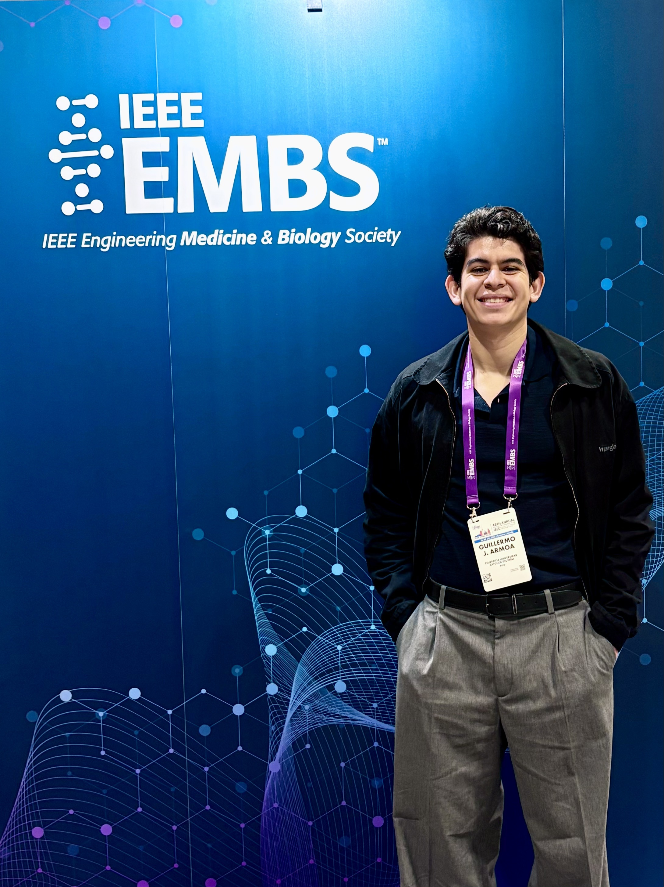

# ASTHRAL

**Astronaut Support Tool for Health Risk Assessment and Logistics** is a research prototype for the [NASA Space Apps Challenge 2026: Health Monitoring Software](https://www.spaceappschallenge.org/2026/challenges/health-monitoring-software/). It brings astronaut health monitoring, mission context, research evidence, and experimental computer vision into one project.

> **Research prototype.** ASTHRAL is not a medical device, NASA system, or flight-qualified tool. Its rules, models, interfaces, and synthetic scenarios have not been clinically or operationally validated. Never use its output to make care or mission-safety decisions.

## Latest software results

These are local software-verification results for the integrated code in `main`, recorded in the [release-candidate report](docs/asthral/FINAL_RELEASE_CANDIDATE_20261115.md). They are not clinical accuracy metrics.

| Check | Result |
|---|---|
| Python engine suite | **958 passed, 19 skipped, 0 failed** (197.50 s; one deprecation warning) |
| Browser-local JavaScript suite | **148 passed, 0 failed** |
| Color-wave regression checks | **3 passed, 0 failed** |
| Chromium visual and synthetic-control checks | **Passed** for the documented routes and controls |
| Offline browser installation | **Passed** for 139 cached resources in the tested Chromium profile |
| Full mission-control browser acceptance | **Incomplete**: an obsolete navigation selector timed out; a later rerun was stopped before completion |

The live CelesTrak request returned HTTP 403 during that run, so it did not verify a current ISS estimate. See the report for exact scope, environment, and limitations. Synthetic software tests do not establish medical-model performance.

## What is in the project

| Area | Purpose and current boundary |
|---|---|
| Health engine | Existing Python/FastAPI engine for deterministic, traceable assessments and longitudinal records. |
| Browser application | `web-local/` contains the static astronaut dashboard, mission context, EVA training flow, and existing health, assistant, voice, and exercise views. |
| Computer Vision | SkinGuard, OcularVision, EchoVision, and MotionGuard are integrated into the existing portal. Their model availability and restrictions are listed below. |
| Local assistant | Optional local Ollama inference; the engine keeps deterministic behavior when the model is unavailable. Model weights are not stored in Git. |
| NASA context | Public historical RadLab records and contextual space-weather information are kept separate from personal health records and clinical rules. |

The Python import namespace is still `vigile` under `engine/vigile/` for compatibility with the original research material and existing code. **ASTHRAL is the current product name.** Historical VIGILE-labelled release packages and source records are retained for provenance; they are not current product instructions. Start with this README and the [ASTHRAL documentation index](docs/asthral/README.md).

## Computer Vision model status

The modules are real software integrations, but a module being present does not mean a suitable model is installed or clinically validated.

| Module | Current state |
|---|---|
| SkinGuard | Accepts and documents images; lesion predictions are unavailable without compatible, reviewed detector weights. |
| OcularVision | Experimental OCT processing; requires the documented local model/runtime assets. General retinal segmentation does not establish SANS detection. |
| EchoVision | Inference is blocked until checkpoint rights and written permission are verified. |
| MotionGuard | Experimental video/landmark analysis; local MediaPipe/runtime assets are optional and outputs are not clinical measurements. |

See [Computer Vision setup, provenance, and limitations](docs/asthral/COMPUTER_VISION.md), [SkinGuard scope](docs/asthral/SKINGUARD.md), and [third-party notices](docs/asthral/THIRD_PARTY_NOTICES.md). Model weights and medical image datasets are not bundled.

## NASA sources and how ASTHRAL uses them

| Official source | Use in ASTHRAL |
|---|---|
| [NASA Human Research Program: risks of human spaceflight](https://www.nasa.gov/hrp/risks/) | Research context for astronaut-health risks. |
| [NASA Spaceflight Human-System Standard, Volume 2](https://www.nasa.gov/reference/nasa-std-3001v2/) | Human-factors and environmental-health design reference only; ASTHRAL does not claim compliance or certification. |
| [NASA OSDR RadLab Data API](https://visualization.osdr.nasa.gov/radlab/gui/data-api/) | Integrated browser explorer for public, historical instrument records. These records are not personal astronaut dosimetry, live crew telemetry, or EVA limits. |
| [NASA CCMC DONKI](https://ccmc.gsfc.nasa.gov/tools/DONKI/) | Contextual space-weather information. It does not independently trigger ASTHRAL clinical or EVA safety decisions. |
| [NASA OSDR data portal](https://science.nasa.gov/biological-physical/data/) | Research-data reference; ASTHRAL does not import every OSDR dataset into personal monitoring. |

NASA sources inform the research context; **NASA has not endorsed, certified, or validated ASTHRAL**. Integration details and data boundaries are documented in [NASA data and anatomy integration](docs/asthral/NASA_DATA_AND_ANATOMY_INTEGRATION.md). The separate scientific-reference search currently uses PubMed/NCBI; see [hybrid retrieval scope](docs/asthral/HYBRID_RAG.md).

## Run locally on Windows

From a clean clone, install the Python engine and build the browser app:

```powershell
git clone https://github.com/GiaDiGr/ASTHRAL.git
Set-Location ASTHRAL\engine
py -3 -m venv .venv
.\.venv\Scripts\python.exe -m pip install -e ".[test,integration]"
.\.venv\Scripts\python.exe tools\setup_asthral.py
Set-Location ..
$env:ASTHRAL_BUILD_OUTPUT = Join-Path (Get-Location) 'web-local\build-output-local'
& .\engine\.venv\Scripts\python.exe .\web-local\build.py
& .\engine\.venv\Scripts\python.exe .\tools\serve_browser_build.py $env:ASTHRAL_BUILD_OUTPUT --port 8919
```

Open `http://127.0.0.1:8919/`. The static browser build does not replace the authenticated Python portal. For the synthetic backend-and-portal demonstration, follow [the demo runbook](docs/asthral/DEMO.md). Do not use real patient or astronaut data.

Optional local Qwen setup is documented in [model provenance and provisioning](docs/asthral/MODELS.md). The model weights, Ollama runtime, voice assets, and optional vision weights must be acquired separately and verified; they are not uploaded to GitHub. No model is silently substituted when one is missing.

## Run the documented checks

Run the Python suite from `engine/` after installing the `test` extra:

```powershell
Set-Location engine
.\.venv\Scripts\python.exe -m pytest -q tests
```

Browser test instructions and the exact build inputs are in the [release-candidate report](docs/asthral/FINAL_RELEASE_CANDIDATE_20261115.md). Results in that report were run locally; this repository currently has no GitHub Actions workflow, so they are not GitHub-hosted CI checks.

## Repository map

```text
engine/                 Python engine, existing API, and tests
web-local/              Browser application, assets, and browser tests
docs/asthral/           Current product, NASA, module, and release documentation
artifacts/              Reproducibility and benchmark evidence
01_INFORMES/–99_.../    Original research lineage and preserved historical material
tools/                  Setup, build, verification, and safe synchronization tools
```

Some large ignored files under `engine/` are local environments or downloaded assets; they are not part of GitHub. The repository has no root `LICENSE` yet. Do not redistribute third-party code, datasets, checkpoints, or media unless their terms permit it.

## Branches and safe collaboration

`main` is the integrated baseline. At the **15 November 2026** audit, all 13 remote `feature/*` branch tips were ancestors of `origin/main` and had no commits unique to those branches. The feature refs remain on GitHub for contributor history; their names do not mean their code is missing from `main`, and they should not be merged again blindly. Check live refs before each task because they can change.

For new work, fetch and inspect the current state, then create a fresh topic branch from the latest `origin/main`. Preserve local changes, never overwrite another contributor's branch, and do not use `git reset --hard`, `git clean`, or force-push to synchronize computers. Review the [contribution and safe-sync guide](CONTRIBUTING.md) and [portability and Git notes](docs/asthral/PORTABILITY_AND_GIT.md) before updating a diverged checkout.

### Instructions for AI coding assistants

1. Check repository root, branch, upstream, and working-tree state before editing. Read this README, `CONTRIBUTING.md`, `SECURITY.md`, and the relevant pages in `docs/asthral/`.
2. Extend the existing engine, session, storage, and UI. Do not create a parallel app or backend, or rename `engine/vigile/` without a migration plan.
3. Preserve work from every machine and branch. Do not infer that code is absent from a branch name; compare the actual tree and history.
4. Never invent model outputs, accuracy, NASA compliance, clinical outcomes, or test results. Separate synthetic software evidence from clinical and operational validation.
5. Report exact changes, commands, test counts, skipped dependencies, incomplete checks, and model availability. Keep medical data, credentials, model weights, and local databases out of Git.

## Project boundaries and governance

- No clinical, operational, NASA, or flight validation is claimed.
- NASA archive and space-weather data do not become individual dose estimates or automatic safety decisions.
- Optional models can be unavailable; a missing model must never be represented with a simulated prediction.
- Project-wide licensing has not been selected. Private repository access does not grant redistribution rights.
- Use synthetic data only. See [SECURITY.md](SECURITY.md) and [third-party notices](THIRD_PARTY_NOTICES.md).

## Team

<table>
  <tr>
    <td align="center" width="33%"><br /><strong>Gianni Di Trani</strong><br />M.Sc. Student in Pure Mathematics</td>
    <td align="center" width="33%"><br /><strong>Fabian A. Nana</strong><br />Biomedical Engineering Researcher</td>
    <td align="center" width="33%"><br /><strong>Guillermo J. Armoa</strong><br />B.Sc. in Biomedical Engineering<br />Data &amp; Intelligence Intern - Healthcare</td>
  </tr>
  <tr>
    <td align="center"><br /><strong>Sergio J.M. Herrera</strong><br />M.Sc. Student in Applied Physics</td>
    <td align="center"><br /><strong>Marfelinda Enciso</strong><br />B.Sc. Student in Bioengineering</td>
    <td align="center"><br /><strong>David Grández</strong><br />CEO, SI &amp; Cybersecurity Consultant</td>
  </tr>
</table>
